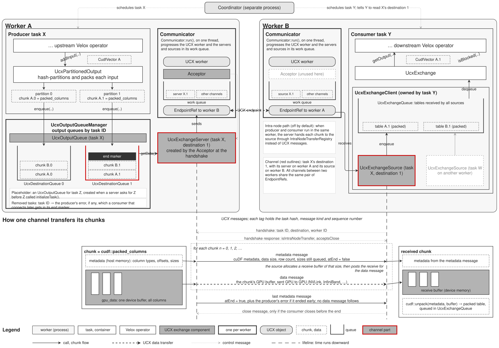

# UCX Exchange: One State Machine for Each Half of a Channel

**Status:** proposal for discussion.
**Scope:** `velox/experimental/ucx-exchange`.
**Author:** dnb@zurich.ibm.com

## Summary

The UCX exchange moves GPU column buffers between Velox tasks over UCX; today
these are the packed tables of the cuDF backend. Many of the fixes it has
received over the last six months share one shape. A channel, the
point-to-point link from one producer task's destination to one consumer, ends
in a way that one component handles. Another component, holding its own copy
of the channel's state, never hears about it. A consumer then waits until its
query is aborted, finishes with rows missing, or leaves memory behind.

A channel spans two workers. Its producer half runs on the producer's worker,
and its consumer half on the consumer's worker, so no structure on one worker
can hold a whole channel. This note proposes one change to the current
design, which also carries the fixes of the open PRs #19047 and #19701:

- Each half of a channel gets one state machine, with a written table of the
  events that end it and the outcome of each.
- Each state machine lives in the object that holds that side's task-wide
  state under one lock: the producer task's output queue, and the consumer's
  exchange queue.
- Only protocol messages carry an outcome from one half to the other: the
  handshake, the end message with the producer's outcome, and the close
  message.
- The protocol gets a version and changes without backward compatibility.
  Workers that speak different versions never crash; the query fails with a
  message that names both versions.
- The server and the source keep only their UCX progress. They report what
  happened on the wire to their half's state machine and act on its decisions.

The design adds no singleton, moves no chunks between components, and changes
no Velox interface.

## Background

The **current design** is the upstream code at the time of writing. The
proposal starts from it. The open PRs #19047 and #19701 fix parts of the same
problem; the proposal takes their fixes into the design, in one change,
instead of landing them first.

### UCX in brief

UCX is a communication library; UCXX is its C++ wrapper, which this exchange
uses. A **UCX worker** is the UCX object that progresses communication; it is
unrelated to the worker processes defined below. An **endpoint** is a
connection from one UCX worker to another. Messages are sent with a 64-bit
**tag**, and a receive posted for a tag completes when a message with that tag
arrives from any endpoint of the UCX worker. A message that arrives before its
receive is posted waits in the UCX worker's queue of **unexpected messages**
until one is. Large messages use a **rendezvous** protocol: the data stays on
the sender until the receiver posts the matching receive. Rendezvous can use a
fast local copy (`cuda_copy`) between GPU buffers in one process.

UCX detects a failed peer only with **peer error handling**, which this
exchange enables through `ucxx.error_handling` (default `true`). Some fabrics,
such as AWS SRD, do not support it; there the setting must be off, and a
failed peer is never reported.

### Terms

The diagram shows each term below in place. Producer task X on worker A sends
its destination 1 to consumer task Y on worker B over one channel, outlined in
red. The lower part shows the messages that channel carries, in time order.

- A **worker** is a process that runs Velox tasks, such as a Prestissimo
  worker, the C++ worker of Presto. The **coordinator**, a separate process,
  schedules tasks on the workers and aborts a query's remaining tasks when the
  query finishes or fails. The worker decides how long a finished `exec::Task`
  object stays alive. A query's exchange connects a producer task on one worker
  with consumer tasks on the same or other workers.
- A **producer task** is a task whose plan ends in a `PartitionedOutputNode`
  that selects the UCX transport. Its drivers run `UcxPartitionedOutput`
  operators, which write **chunks** into the task's **output queue**
  (`UcxOutputQueue`). A chunk is the unit a server sends as one metadata
  message and one data message; today it is a cuDF table packed into
  `cudf::packed_columns`.
- An output queue holds one **destination** queue (`UcxDestinationQueue`) per
  consumer that reads from the producer task: one per partition for a
  partitioned output, one per consumer for a broadcast. One lock in the output
  queue guards all of its destination queues. A destination is **published**
  once its queue exists in the output queue: at `initializeTask()`, or, for
  broadcast, when `updateOutputBuffers()` announces it. A broadcast output
  queue keeps its chunks for destinations that arrive late. The chunks
  a destination queue holds are its **results**. The **end marker** is a null
  chunk that ends a destination's channel; the output queue queues it once
  every driver of the producer task called `noMoreData()`.
- The **output queue manager** (`UcxOutputQueueManager`) is a singleton on each
  worker. It holds the output queues of the producer tasks running on that
  worker, keyed by task ID, and implements Velox's `exec::OutputBufferManager`
  interface for the UCX transport.
- A **consumer task** is a task with an `ExchangeNode` that selects the UCX
  transport. The task owns one `UcxExchangeClient` per such node, shared by the
  node's `UcxExchange` operators. The client owns one **source**
  (`UcxExchangeSource`) per producer task it reads from, and one **exchange
  queue** (`UcxExchangeQueue`), into which all its sources put the tables they
  receive.
- A source connects to the worker of its producer task. On that worker, the
  `Acceptor` creates a **server** (`UcxExchangeServer`) when the source's
  handshake arrives. A server serves one destination of one producer task: it
  waits for that destination's next chunk, which makes it the destination's
  **reader**, and sends the chunk to its source.
- A **placeholder** is an output queue that the output queue manager on the
  producer's worker creates when a server asks it for a task that has not
  called `initializeTask()` yet. The server's request waits in the
  placeholder, and when the task calls `initializeTask()`, the placeholder
  becomes the task's output queue.
- The **Communicator** is a singleton on each worker that serves both its
  producer and its consumer tasks. It owns the worker's UCX worker, a work
  queue, and the endpoints to and from the worker's peers. All channels
  between two workers share these endpoints. The worker process runs the
  Communicator's event loop, `Communicator::run()`, on one thread of its own.
- The **intra-node path** hands chunks between a server and a source in the
  same worker through the **intra-node registry**
  (`IntraNodeTransferRegistry`) instead of UCX transfers. It is off by default
  (`cudf.intra_node_exchange`), and it is not used for broadcast or for
  placeholders.
- A **channel** is one producer task and destination together with the server,
  on the producer's worker, and the source, on the consumer's worker, that move
  its chunks. Its **producer half** is the destination queue and its server;
  its **consumer half** is the source and the tables it has put into the
  exchange queue. A channel is neither the UCX endpoint, which all channels to
  one peer share, nor a consumer's set of sources.
- A channel's **outcome** is how it ended: cleanly, or with an error and the
  error's message.

### How a chunk travels

1. A producer driver calls `UcxOutputQueueManager::enqueue()`. If a server is
   waiting on that destination, its callback runs on the producer's driver
   thread, stores the chunk, and puts the server on the Communicator's work
   queue.
2. On the Communicator thread, the server sends a metadata message and then
   the data. Each message has a tag built from a hash of the task ID and
   destination, an operation byte and a sequence number.
3. The source receives both on the Communicator thread and puts the table into
   the exchange queue, where the consumer's drivers read it.
4. A channel ends with a metadata message that has `atEnd` set. Right after
   posting that send, the server deletes the destination's results.

### Who touches a channel's state

In the current design, the channel state is distributed across multiple
components, as shown in the table below. #19701 would add the items marked
(†).

| Component | Channel state |
|---|---|
| `UcxOutputQueueManager` | output queues and placeholders by task ID; IDs of removed tasks; the producer's error for each removed task (†); tasks whose initialization failed (†); readers arriving at placeholders (†) |
| `UcxOutputQueue`, `UcxDestinationQueue` | chunks, the waiting reader's callback, readers of unpublished destinations (`pendingQueues_`), end marker, `terminated_` |
| `IntraNodeTransferRegistry` | published intra-node chunks, IDs of cancelled tasks; tasks held still during removal (†) |
| `UcxExchangeServer` | a 7-state machine, the chunk in flight, UCX requests, a closed flag; whether its consumer is gone, and whether its source sent the close message (†) |
| `UcxExchangeSource` | an 8-state machine; end-of-stream, closed, end-marker-delivered and registered flags; a backpressure flag; UCX requests; whether its server accepts the close message, and whether its endpoint closed (†) |
| `UcxExchangeQueue` | received tables, the number of sources that ended, `atEnd_`, one error for the whole consumer |
| `UcxExchangeClient` | its sources, `closed_` |
| `Communicator`, `EndpointRef` | registered sources and servers, endpoints, deferred cleanup |

These components are called from at least five kinds of threads:

- producer drivers, through `enqueue()`, which fires reader callbacks;
- consumer drivers, which read tables and release backpressure;
- the Communicator thread, for UCX callbacks and the servers' and sources'
  `process()`;
- the thread that runs `Task::terminate()`, which calls `removeTask()` for a
  producer and closes the client of a consumer;
- the worker's other threads, such as those that handle the coordinator's
  requests, through `stats()` and `updateOutputBuffers()`.

In the current design, the headers in `velox/experimental/ucx-exchange` declare
11 locks and 10 atomic members, in about 7,500 lines of code without tests. The
components refer to each other by task-ID strings and tag hashes.

## The problem

### The pattern in the fixes

| PR | What went wrong | Where the state diverged |
|---|---|---|
| #17752 | closing one `UcxExchange` closed a client that its siblings still used | operator vs. shared client |
| #17753 | a consumer whose handshake arrived while its producer was initializing missed the intra-node path | queue initialization vs. the Acceptor |
| #18921 (closed after openucx/ucx#11319) | a consumer that connected before its producer initialized never got the intra-node path | placeholder vs. initialized queue |
| #19047 (open) | with `UCX_RNDV_THRESH=0`, which makes every message use rendezvous, a consumer that closed before posting its last receive left the producer task `RUNNING` | source vs. server vs. output queue |
| #19064 | a broadcast reader that connected before its destination was announced waited forever when data or the end marker was already queued | reader vs. destination publication |
| #19701 (open) | a producer that failed or was aborted ended its channels cleanly, so a TPC-DS query returned 0 rows | output queue vs. server vs. registry |
| #19859 (open) | producer backpressure counted queued bytes, consumer backpressure counted queued tables, and neither counted GPU memory still in use after dequeue | queue vs. server vs. consumer |

#19701 shows the pattern from the inside. Review of its first drafts found
three races of this kind in its own new code:

- A chunk that a source had already read from the intra-node registry, but
  whose read the server had not processed yet, was counted as lost when the
  producer was removed in between
  ([comment](https://github.com/facebookincubator/velox/pull/19701#discussion_r4378663516)).
- A server could create a placeholder between the two lookups that one
  `removeTask()` call makes, and that placeholder then ended cleanly instead of
  with the producer's error
  ([comment](https://github.com/facebookincubator/velox/pull/19701#discussion_r4378734102)).
- The record of a removal in the output queue manager and the one in the
  intra-node registry could carry different reasons
  ([comment](https://github.com/facebookincubator/velox/pull/19701#discussion_r4554522671)).

It also found older cases in the current design, which #19701 fixes:

- Records of removed tasks are freed only when a task ID is initialized or
  removed again, which Presto never does, so they stay for the life of the
  worker ([comment](https://github.com/facebookincubator/velox/pull/19701#discussion_r4554522689)).
- A placeholder for a producer that never arrives outlives the server that
  waited on it, and stays for the life of the worker.
- A server whose consumer closed early keeps waiting, with the results kept
  for that consumer, until the producer is removed.

The consumer half has cases of its own, found while preparing this note. A
source checks its closed flag when a data message arrives, then puts the table
into the exchange queue. If the client's close empties the queue between the
check and the put, the late table stays in the closed queue, holding GPU
memory until the consumer's `Task` is destroyed. After one source fails, the
other sources keep putting tables into the queue until the client closes,
although no driver reads them any more.

The producer half has one more, also found while preparing this note. When a
server's send fails, the server stops without deleting its destination's
results or releasing its reader, so the producer task stays `RUNNING` until it
is removed. #19047 keeps this behavior on purpose for the last metadata
message and leaves the task for the coordinator to remove.

Each fix so far has handled one of these cases where it was found.

### Root causes

**No component owns a channel's ending.** A channel can end in at least six
ways:

- every producer driver calls `noMoreData()`;
- the producer task is removed (`removeTask()`), which `Task::terminate()`
  does when the task finishes, fails, or is aborted or cancelled;
- the destination's results are deleted (`deleteResults()`), by the server
  after the end marker, or by the producer itself when it runs out of GPU
  memory;
- the consumer closes;
- the connection fails;
- on the intra-node path, a published chunk is never read.

Each event reaches some of the components above and not others. On the
producer side, the output queue, the output queue manager and the server each
decide part of the ending. On the consumer side, the source, the exchange queue
and the client do. The endings are not written down anywhere, so every new
way to end a channel needs a fix at every boundary it crosses.

**Task lifetime clashes with UCX connection lifetime.** A Velox `Task` lives
as long as the worker keeps it. A UCX connection lives as long as the network
and the peer allow. A consumer can connect, and so create a server, before its
producer task exists or long after it is gone. The only link between the two is
the task ID. The code bridges the gap with placeholders and records of removed
tasks, both kept in side maps keyed by task ID. Their lifetime follows from the
`Task`'s lifetime only indirectly, and the cases above show both staying for
the life of the worker.

**The protocol carries little of the lifecycle.** In the current design, the
wire format has no way to say why a channel ended and no message for a consumer
that leaves early. Its only version check is a magic number that the receiver
verifies with `VELOX_CHECK` inside a UCX callback, which the Communicator loop
does not catch, so a mismatch aborts the worker. State therefore has to be
inferred: an unknown task ID means "not created yet", and a silent consumer
means "still reading".

**Two transports double the cases.** The intra-node path has its own registry
and its own handoff. With #19701, removing a task also has to coordinate with
the registry and count the chunks in flight there. Two of the three races in
#19701's drafts exist only on that path.

**Endings are task-wide, but only the consumer decides them under one lock.**
The decisions that end a channel concern the whole task on both sides:

- On the producer side, removing a task ends all of its destinations at once,
  and whether that end is clean depends on what all of them still hold. The
  count of drivers that called `noMoreData()`, and a broadcast's chunks for
  later destinations, are per task as well.
- On the consumer side, the consumer has finished when every source has ended,
  and it fails when any source fails.

The consumer side keeps these under one lock: the exchange queue's lock guards
the count of sources that ended and the one error, and the client's closed
flag is changed under the same lock. The producer side does not. With #19701,
removal reads the output queue under its lock, releases it, and then retries
under the manager's lock until the queue stops changing; on the intra-node
path it also holds the registry still. Two of the races in #19701's drafts
came from the gaps between those steps.

## Goals

- Every reader gets exactly one outcome: a chunk, a clean end, or an error that
  says why the channel ended.
- Each half of a channel decides its outcome once, in one place, and the
  protocol carries that decision to the other half.
- Every way a half can end is listed in one table, with one test each.
- No state outlives what needs it: a removed task's `UcxOutputQueue` is dropped
  once its `Task` is gone, and a channel's state ends with its last participant.
- Each half can be tested on its own, without UCX.
- A worker never crashes on a peer that speaks another protocol version.
  The query fails instead, with a message that names both versions.

## Requirements

- No change to the Velox core interfaces (`exec::OutputBufferManager`,
  `exec::ExchangeClient`).
- No change to the data encoding: `cudf::packed_columns` and its cuDF
  metadata stay as they are. Only the exchange's own messages change.
- No backward compatibility. The exchange's messages may change in whatever
  way is most efficient, under one condition: workers with an older or newer
  version fail gracefully. Neither worker crashes, and the query fails with a
  message that says why. A cluster runs one version; a query that spans
  workers of two versions fails.
- UCX and UCXX remain the transport.
- The data path stays zero-copy, with no new copies or synchronization per
  chunk.

The proposal inherits one limit of UCX. With `ucxx.error_handling` off, a
failed peer is never reported, so a channel to that peer ends only when one of
its tasks ends, for example when the coordinator aborts the query.

## Proposal

### Starting point

The proposal goes from the current design to the design in one change, which
replaces #19047 and #19701. It takes these fixes from them:

- from #19047: a producer finishes only after the send of its last message
  completed; the close message for a consumer that leaves early; each server
  bound to the output queue it started with, so that it looks its task ID up
  only once; the release remembered for a consumer that closed before its
  producer initialized; and sources added after the close that still tell
  their server;
- from #19701: the producer's error in the last message of a channel; that
  error kept for consumers that connect after the producer was removed; a
  consumer that fails when its endpoint closes, its metadata cannot be
  decoded, or its producer's worker cannot be resolved; and an error for
  consumers of a task whose `initializeTask()` threw.

Both PRs had to stay compatible with the current wire format, so #19701 adds a
capability flag for the close message and leaves older consumers unable to see
the producer's error. The design drops that constraint and versions the
protocol instead (see the protocol rules).

The two PRs disagree on two points:

- On removal, #19047 deletes the queued output and ends each destination with
  a clean end marker, while #19701 sends the producer's error. The tables below
  follow #19701, because a clean end after lost output is the row loss #19701
  fixes.
- When a consumer closes before its producer initialized, #19701 drops the
  placeholder, while #19047 remembers the release so that the producer can
  finish once it initializes. The tables below follow #19047, because
  otherwise the producer waits until the coordinator removes it.

The intra-node path is out of scope; its removal is a separate change (see
Related change). Two of the three races in #19701's drafts go away with it,
not with this design.

The test of each fix comes along with it; How the design relates to existing
fixes maps every test to a row of the outcome tables.

### Where each half's state lives

Each half's state machine goes into the object that holds its side's task-wide
state: one state per destination inside `UcxOutputQueue`, and one state per
source inside `UcxExchangeQueue`. Every decision that ends a channel is taken
under that object's lock. These are the mutexes that the two classes have today,
called `UcxOutputQueue.lock` and `UcxExchangeQueue.lock` below. On the consumer
side, this keeps the lock that already decides endings. On the producer side,
each task's `UcxOutputQueue` stays one object for its whole life, so removal is
decided under `UcxOutputQueue.lock` in one step, instead of the read, release
and retry described under Root causes. Velox's CPU exchange makes the same
choice: one lock per task's output buffer, over its destination buffers.
`QueueManager.lock` is the one lock of `UcxOutputQueueManager` over its map from
task ID to `UcxOutputQueue`.

### The producer half

`UcxOutputQueueManager` keeps one map, from task ID to `UcxOutputQueue`. In the
current design, the manager keeps two maps: `queues_` holds the output queues
and the placeholders, and `removedTasks_` the IDs of removed tasks, whose late
readers get a clean end. #19701 would add two more: `failedInitializations_`,
the tasks whose `initializeTask()` threw, and `numArrivingReaders`, which
counts for each placeholder the readers that have not installed themselves
yet. The one map replaces all of them, and that count becomes part of a
Pending `UcxOutputQueue`:

| Task state | Entered when | Left when |
|---|---|---|
| Pending | a server asks for a task the output queue manager has not seen | `initializeTask()` or `removeTask()`; or its last waiting server closes while no destination is Released |
| Active | `initializeTask()` | `removeTask()` |
| Removed | `removeTask()` | the next removal after the producer's `Task` is destroyed drops it, or the task ID is initialized again |

The task's `UcxOutputQueue` stays the same object from Pending to Removed. A
placeholder becomes the task's output queue at `initializeTask()`, as in the
current design. Removal turns the same object into a Removed `UcxOutputQueue`:
it frees the chunks and keeps only a `std::weak_ptr` to the producer's `Task`
and the outcome. It must not hold a `std::shared_ptr`, or the `Task` would never
be destroyed. For a task whose `initializeTask()` threw, the output queue
manager keeps the `Task` from that call. A server whose handshake names a
Removed task is bound to that `UcxOutputQueue` and sends the end message with
the stored outcome. `updateOutputBuffers()` for a Removed task does nothing.

Because the `UcxOutputQueue` keeps its identity, every change of the task's
state and of its destinations' states happens under `UcxOutputQueue.lock`.
`QueueManager.lock` only adds and erases `UcxOutputQueue` objects in the map. It
adds one on the first contact for a task ID, from `initializeTask()` or a
server's request. It erases one when its `Task` is gone, or when the last server
of a Pending `UcxOutputQueue` closes. No decision is made under
`QueueManager.lock`. A server that looks up a task during its removal therefore
finds the same `UcxOutputQueue` and reads its decision; it cannot create a new
placeholder in between.

A Removed `UcxOutputQueue` lives long enough for the consumers that need it. A
producer that succeeds cannot be removed before its consumers connect: `Task`
reports itself finished only after each destination's end marker was sent or its
consumer left. Only a failed or aborted producer is removed early, and a
consumer that connects while its `Task` exists gets the producer's error from
the Removed `UcxOutputQueue`. This relies on the worker keeping a finished
`Task` until the coordinator has seen it end; the coordinator then aborts the
query's consumers. Prestissimo keeps a terminated `Task` for
`old-task-cleanup-ms`, 60 seconds by default (see Open questions for other
workers). A consumer that connects after the `Task` is gone creates a Pending
`UcxOutputQueue`, which ends when that consumer is aborted and its server
closes.

When a consumer of a Pending task closes, through the close message or a closed
endpoint, the Pending `UcxOutputQueue` keeps that destination as Released, and
nothing else: no reader and no chunks. When the task initializes, the
destination starts Released, so the producer can finish without waiting for the
coordinator. Such a `UcxOutputQueue` lives until the task initializes or is
removed. If the task never starts on this worker, it stays for the life of the
worker; it holds only the task ID and the released destinations. A Pending
`UcxOutputQueue` whose last server closes without having released its
destination is dropped.

Inside the output queue, each destination has one state:

| Destination state | Meaning |
|---|---|
| Unpublished | a reader waits; the destination is not announced yet |
| Open | chunks flow to its reader |
| Ended(outcome) | the end marker, or the error, is decided and queued |
| Released | its results are deleted; nothing more is sent |

The producer's **outcome table** lists each event that can end a destination
and its outcome. Removal decides for all destinations of the task at once; the
other events decide for one destination. The first decision for a destination
wins:

| Event | Outcome |
|---|---|
| every driver called `noMoreData()` | none yet; the end marker is queued behind the remaining chunks |
| the server takes the end marker | clean |
| `removeTask()`, after every driver called `noMoreData()`, with no chunk left in any destination | clean, even if the task is aborted at that point |
| `removeTask()` with chunks left in any destination, in a broadcast's chunks kept for later destinations, or in flight on the intra-node path; or before every driver called `noMoreData()` | producer error, with the task's state and error message |
| `removeTask()` without a successful `initializeTask()` | error: the producer never initialized its output |
| `deleteResults()` while the destination is Open, as the producer does when it runs out of GPU memory | error: the producer discarded its output; the results are deleted, and the server sends the error |
| `deleteResults()` after Ended, as the server does once the send of the end message completed | none; the destination becomes Released |
| a reader for a destination beyond the final count | clean, at once, as in the current design: no rows are ever produced for such a destination |
| the close message arrives, or the endpoint closes | none for the consumer, which is gone or sees its endpoint close; the destination becomes Released and its results are deleted |
| a send fails while the endpoint stays open | error: the output queue fails the producer task with the send's error (`Task::setError()`), so the coordinator aborts the query; the consumer, whose receive may never fail, is aborted with it. #19047 leaves the task `RUNNING` instead |
| the close message, or a closed endpoint, for an Unpublished destination of a Pending or Active task | none; the destination is Released before it is published, and publishing it later keeps it Released, as #19064 and #19047 do |

Releasing the destination when the consumer is gone matches Presto's HTTP
exchange, whose consumer deletes its results on the producer when it aborts.
A producer that is aborted later, as after a satisfied `LIMIT`, then finds the
destination already Released. The destination's state tells the two uses of
`deleteResults()` apart, so its signature does not change. When the producer
runs out of GPU memory, the "discarded" error comes first and the later
`removeTask()` keeps it, so the consumer fails either way.

The server keeps its UCX progress: waiting for a chunk, sending, waiting for
the send to complete. It reads its destination's state through the output
queue it is bound to and reports three events: the close message arrived, its
endpoint closed, and a send failed. As in #19701, the Communicator tells every
server and source on a closed endpoint through `onEndpointClosed()`; in the
current design, a closed endpoint only closes them. UCX reports a closed
endpoint only with `ucxx.error_handling` on.

### The consumer half

`UcxExchangeQueue` keeps one state per source:

| Source state | Entered when |
|---|---|
| Registered | the client adds the source |
| Open | the handshake response arrives |
| Ended(outcome) | the source reports an end: clean, the producer's error, or a transport error |
| Released | the client closes |

The consumer's **outcome table** lists each event that can end a source and
its outcome. The first decision for a source wins:

| Event | Outcome |
|---|---|
| the end message, without an error | clean |
| the end message, with the producer's error | producer error; the consumer fails |
| a handshake response of another protocol version | version error, which names both versions; the consumer fails |
| a failed connect, handshake or receive, an undecodable message, or a failed allocation | transport error; the consumer fails |
| the endpoint closes | transport error, unless the source is already Ended or Released |
| the client closes | none; the source becomes Released, and its server is told with the close message if the channel has not ended |
| the client adds a source after it closed | none for the consumer; the source still connects and sends the close message, so that its producer can finish, and is then Released |

The consumer has finished when the client called `noMoreRemoteTasks()` and every
source's state is Ended or Released; with no sources, that is at once. It fails
when any source's state ends with an error before the client closes. In the
current design, these are the exchange queue's count of sources that ended and
its one error; both become views of the per-source states. Once the consumer
has failed or closed, `UcxExchangeQueue` frees every table a source puts into
it, from any source. It collects them under `UcxExchangeQueue.lock` and frees
them after the lock is released.

The source keeps its UCX progress: connecting, the handshake, waiting for
metadata, waiting for data, and done. It reports every end through one call,
`end(outcome)`. That call replaces the paths that each decide part of the
end: delivering the end marker, failing the source and closing it in the
current design, and handling a closed endpoint, which #19701 adds. They rely
on a compare-and-swap on the end-marker flag and on the exchange queue keeping
only its first error.

A source that closes before the handshake response arrives does not know yet
whether its server exists: the Acceptor creates the server and then sends the
response. The handshake and the close message also travel by different UCX
mechanisms, an active message and a tagged send, so UCX does not keep them in
order. The source therefore waits for the response and then sends the close
message, unless the response rejected the handshake. The wait ends when the
endpoint closes or after a timeout; with `ucxx.error_handling` off, only the
timeout ends it. A source that gets no response sends nothing.

A consumer close and the end of a channel can race in four ways:

- **Clean end and close at the same time.** Only one of them is counted. In the
  current design, the compare-and-swap on the end-marker flag ensures that; in
  the design, the source's state in `UcxExchangeQueue` does.
- **The producer's error and close at the same time.** In the current design,
  the error and the client's closed flag are both set under the queue's lock,
  and a read checks the closed flag first, so a close hides an error that came
  before it. In the design, the first decision wins: an error recorded before
  the close still fails the reads after it, as #19859 requires
  (`terminalClientErrorIsNotMaskedByClose`). An error that arrives after the
  close is ignored; it belongs to a task that is ending anyway, for example
  after a satisfied `LIMIT`.
- **The close message and the end at the same time.** A source sends the close
  message only if it has not yet seen the end. If the server ended first, the
  producer's Communicator still receives the message and drops it (see the
  protocol rules).
- **A table in flight at close.** In the design, the table is freed, as
  described above. In the current design, it stays in the closed
  queue.

### Between the halves: the protocol

The protocol messages are the only transitions that cross workers:

| Message | Producer half | Consumer half |
|---|---|---|
| handshake, with the protocol version | binds a server to a Pending, Active or Removed `UcxOutputQueue`, if the versions match | Registered, waiting for the response |
| handshake response, with the protocol version | — | Open if the versions match; otherwise Ended with a version error |
| metadata and data messages | Open | Open |
| end message, with the outcome and the producer's error, if any | Ended | Ended, with the same outcome |
| close message | Released | Released |
| endpoint closed | Released | Ended with a transport error, unless already Ended or Released |

The design does not keep the current wire format. Every message may change in
the way that is most efficient for the design, and no flag says what a peer
understands. Instead, both sides check one protocol version and accept only
their own:

- **The protocol version.** The handshake and the handshake response each
  carry one version number, which every change of the wire format increments.
  A server accepts only a handshake of its own version, and a source only a
  response of its own version. There are no capability flags: two workers
  either speak the same protocol or fail the query.
- **A fixed prefix.** Two things stay fixed in every version, so that any two
  versions, including the current design, can tell each other apart without
  crashing. The handshake begins with the current design's fields at their
  current offsets, `taskId`, `destination` and `workerId`, and carries the
  version after them; later versions may append fields, but never remove
  these, and it travels as the same active message, to the same receiver
  callback. The handshake response is 16 bytes in every version, twice the
  current design's 8, carries the version beyond its first 8 bytes, and uses
  the current design's response tag.
- **An end message.** The last message of a channel is an end message with
  the outcome, clean or failed, and the producer's error, if any, instead of a
  metadata message whose `atEnd` flag is set. It is sent with the next
  metadata tag, so the source's posted metadata receive takes it. A clean end
  is a few bytes. The error is truncated to a bound at whole characters, as
  #19701 does.
- **One close message.** A source that leaves early sends one close message
  that names its channel: the producer's task ID and the destination, not only
  the tag's 32-bit hash. It is always understood, since the versions match.
- **One close receive per worker.** Instead of one close receive per server,
  as in #19047 and #19701, the Communicator keeps one receive that matches
  every close message on its worker. It hands each message to the server it
  names, or drops it if that server has already ended. With a receive per
  server, a close message that arrives after its server ended is never
  received: it stays in UCX's queue of unexpected messages for the life of the
  UCX worker, and with `UCX_RNDV_THRESH=0` the consumer's send never completes
  either.
- **No check that aborts the worker.** In the current design, the metadata
  message's magic number and the handshake's size are checked with
  `VELOX_CHECK` inside UCX callbacks, which the Communicator loop does not
  catch. In the design, a message that cannot be decoded fails its channel
  with an error; a handshake too short to name its channel is logged and
  dropped. The version check makes these cases rare, but a corrupt message
  must not end the worker.
- **Further control messages.** Later changes, for example messages for flow
  control, which #19859 approaches today by counting on each side, increment
  the version.

A worker meets a peer of another version in three ways. None of them crashes
either worker, and each fails the query with a message:

| Producer's worker | Consumer's worker | What happens |
|---|---|---|
| current design | design | The current Acceptor accepts the longer handshake, because it checks only that a handshake is at least as long as its own, creates a server, and sends its 8-byte response. The source reads no version beyond those 8 bytes, sends nothing more, and fails the consumer: the producer's worker runs an older protocol version than this worker's. The current server keeps sending to a source that no longer receives. Its metadata messages wait unmatched in the consumer's UCX worker, and its first data send never completes, so the producer task stays `RUNNING` until the coordinator aborts it. |
| design | current design | The Acceptor finds no version in the 272-byte handshake. It creates no server, logs the mismatch, and fails the producer task with it if the task is Active on this worker. It sends its 16-byte response; the current source's 8-byte receive fails with a truncation error, which fails the consumer. A test must confirm that UCXX reports the truncation to the receive's callback as a status. |
| design, version N | design, version M | The Acceptor creates no server and sends a response that rejects the handshake and names version N. The source fails the consumer with both versions. The Acceptor also fails the producer task if it is Active. |

Both workers keep running and serve other queries. A rolling upgrade
therefore fails the queries that span the two versions, until every worker
runs the new one.

### Rules for both halves

- Every event in the tables above goes through the object that holds its half's
  state. State changes happen under the lock that guards it: `UcxOutputQueue.lock`
  on the producer side, `UcxExchangeQueue.lock` on the consumer side.
- Reader callbacks and promises run after that lock is released, as the code
  already does. Chunks and tables that `UcxOutputQueue` or `UcxExchangeQueue`
  frees are freed after the lock is released, too.
- Every decision for a task is made under `UcxOutputQueue.lock`.
  `QueueManager.lock` only adds and erases `UcxOutputQueue` objects; when both
  are needed, as when erasing one, `QueueManager.lock` comes first. No lock of
  the `Task` is taken while `UcxOutputQueue.lock` is held. Removal reads the
  task's state and error message before it takes `UcxOutputQueue.lock`; they are
  final by then, because `Task::terminate()` sets the task's final state before
  it calls `removeTask()`. #19047 reads `Task::isRunning()` under the output
  queue's lock; under this rule, that read moves before the lock.
- `initializeTask()` for a task ID in Removed replaces the `UcxOutputQueue` in
  the map with a new one, under `QueueManager.lock`. This is the only time a
  `UcxOutputQueue` is replaced. Servers that still hold the old `UcxOutputQueue`
  see it as Removed. Presto does not reuse task IDs, but the tests do.
- `UcxOutputQueue` and `UcxExchangeQueue` treat chunks and tables as opaque
  handles and never look inside them, so the lifecycle does not depend on the
  backend that produced them. That keeps the transport engine-agnostic, as
  Velox's GPU acceleration guide describes it.
- Neither keeps memory accounting of its own. #18590 (open) charges the chunks
  that `UcxPartitionedOutput` queues to a per-query exchange pool in Velox's
  memory system, and a chunk releases its charge when it is freed. The job of
  `UcxOutputQueue` is to free its chunks when its channel is released or ends
  with an error. No state that outlives a channel, such as a Removed
  `UcxOutputQueue`, may hold a chunk.
- Each table is implemented as one function from the current state and an
  event to the next state and its outcome. Each row gets one test, run against
  `UcxOutputQueue` or `UcxExchangeQueue` alone, without UCX.

### What changes where

The first two diagrams show, for the producer half and then for the consumer
half, which object holds each piece of channel state in the current design and
where it lives in the design. The left side shows the current design with the
additions of #19701, which are marked †. Solid arrows show state that moves,
dashed grey arrows show state that stays where it is, and dotted orange arrows
show a field that is removed.

The list below describes the same changes component by component.

- **`UcxOutputQueueManager`** keeps one map from task ID to `UcxOutputQueue`,
  whose state is Pending, Active or Removed, instead of the current design's
  `queues_` (output queues and placeholders) and `removedTasks_`, and the
  `failedInitializations_` that #19701 would add; #19701's count of arriving
  readers becomes part of a Pending `UcxOutputQueue`. The task's
  `UcxOutputQueue` stays the same object from Pending to Removed; removal frees
  its chunks and keeps only a `std::weak_ptr` to the `Task` and the outcome, and
  the `UcxOutputQueue` is erased once the `Task` is gone. `QueueManager.lock`
  only adds and erases `UcxOutputQueue` objects. This fixes side maps that had
  to agree with each other and could stay for the life of the worker, and the
  race in which a server created a placeholder between two lookups of one
  `removeTask()` call: a server that looks up a task during its removal now
  finds the same `UcxOutputQueue`. It also fixes the clean end that a late
  reader of a failed producer gets from `removedTasks_` in the current design:
  it gets the producer's error, as with #19701.
- **`UcxOutputQueue`** gives each destination a state, Unpublished, Open, Ended
  or Released, and implements the producer's outcome table as one function of
  state and event. `removeTask()` decides the outcome for all destinations in
  one step under `UcxOutputQueue.lock`, after reading the task's final state and
  error, and moves the task to the Removed state in place. This removes the
  read, release and retry sequence of removal, where races came from, and turns
  the producer's endings into one table: a new ending becomes one new row, not
  fixes in several components.
- **`UcxExchangeServer`** keeps only its UCX progress, reads its destination's
  state through the output queue it is bound to, and reports three events: the
  close message, endpoint closure and a failed send. It ends a channel with
  the end message, which carries the producer's error, as with #19701. A send
  that fails while the endpoint stays open fails the producer task. As with
  #19047, the
  destination's results are deleted when the last send completes, not when it
  is posted. This fixes the clean end of a failed producer, which loses rows,
  and a failed send that left the producer `RUNNING` until the coordinator
  removed it.
- **`UcxExchangeQueue`** keeps one state per source, Registered, Open, Ended or
  Released, and implements the consumer's outcome table. Whether the consumer
  has finished or failed becomes a view of those states, and once it has failed
  or closed, the queue frees every table that still arrives, after releasing
  its lock. This fixes a table that arrives during a close and holds GPU memory
  until the consumer's `Task` is destroyed, and tables from other sources that
  pile up after one source failed.
- **`UcxExchangeSource`** keeps only its UCX progress and reports every end
  through one call, `end(outcome)`. That call replaces the paths that each
  decided part of the end with flags of their own; the end-marker-delivered and
  registered flags go away. It checks the version in the handshake response.
  A source that closes during the handshake waits, with a timeout, for the
  response and then sends the close message. As with #19701, a closed
  endpoint, an undecodable message and an unresolvable producer worker fail
  the consumer. This removes the place where the close and end races lived,
  and fixes a consumer that leaves early without telling its producer, and a
  close during the handshake that never reaches its server with #19701.
- **`UcxExchangeClient`** releases its sources' states in `UcxExchangeQueue`
  when it closes, so the closed state lives there rather than in a flag of its
  own. A source that the client adds after closing still connects and sends the
  close message, as #19047 does, so that its producer can finish. The client and
  the queue then have nothing left to keep consistent.
- **`Communicator`** keeps one receive for every close message on its worker
  and hands each message to its server, or drops it if that server has
  ended. Servers no longer post and cancel close receives of their own. This
  fixes a close message that arrives after its server ended: with a receive
  per server, as in #19047 and #19701, it stays in UCX for the life of the
  worker, and with `UCX_RNDV_THRESH=0` the consumer's send never completes. As
  in #19701, the Communicator also tells every server and source on a closed
  endpoint through `onEndpointClosed()`.
- **`Acceptor`** checks the handshake's version. On a mismatch, it creates no
  server, answers with a response that names its version, and fails the
  producer task if it is Active. A handshake too short to name its channel is
  logged and dropped instead of failing a `VELOX_CHECK` in the callback. This
  fixes a protocol mismatch that aborts the worker.
- **`UcxExchangeProtocol`** gets the versioned handshake and handshake
  response, the end message and the close message, and decoding that returns
  an error instead of failing a `VELOX_CHECK`.
- **`EndpointRef`** records why UCX closed its endpoint and passes that
  reason to every server and source on it, so that the consumer's error names
  the cause, as #19701 does.

The components still hold state after this change, but only one kind of it
decides how a channel ends. On the producer side, that lifecycle state lives
only in the `UcxOutputQueue` of each task: the task's state, and the state of
each destination inside it. Every event that can end a channel goes to the
`UcxOutputQueue`:

- Velox's calls, `initializeTask()`, `removeTask()`, `noMoreData()` and
  `deleteResults()`, reach the `UcxOutputQueue` through the
  `UcxOutputQueueManager`.
- A server is bound to its `UcxOutputQueue` once, at the handshake. It asks the
  `UcxOutputQueue` for its next step, which is to send a chunk, send the end
  message with the stored outcome, or stop. It reports the close message, which
  the Communicator hands to it, endpoint closure and failed sends back to the
  `UcxOutputQueue`.

The `UcxOutputQueue` decides under `UcxOutputQueue.lock`, and the other
components act on that decision. What they keep is transport state: the
server's UCX requests and the chunk in flight, and the Communicator's endpoints
and work queue. None of it records whether a channel is open or how it ended.
The consumer side follows the same pattern, with the per-source states in
`UcxExchangeQueue`, a source that keeps only its receives, and a client whose
close goes to those states.

The last two diagrams show the calls that record a state change in
`UcxOutputQueue` and in `UcxExchangeQueue`, and the state that each caller gets
back. Solid arrows are calls, dashed green arrows are state returned to the
caller, and a dashed grey arrow shows the Communicator thread handing an event
to the server or the source. Where the note does not state a thread or a return
value, the diagram says so.

Compared with landing #19047 and #19701, the design changes five behaviors,
each one a fix:

- a send that fails while its endpoint stays open fails the producer task,
  instead of leaving it `RUNNING` until it is removed;
- tables that arrive after the consumer failed or closed are freed;
- a close message that arrives after its server ended is received and
  dropped, instead of staying in UCX for the life of the worker;
- a source that closes during the handshake tells its server once the
  response has arrived. With #19701 it never tells the server;
- a peer of another protocol version fails the query with a message. In the
  current design, a mismatch aborts the worker; #19701's capability flag
  covers only the close message, and older consumers still read a failed
  producer's end as clean.

## How the design relates to existing fixes

The design is judged against the fixes already merged and the open PRs it
replaces, in two ways. First, the tests these PRs add are the contract: each
must pass on the design unchanged, unless the note names it as a deliberate
change. Second, a few measures show whether the state really moves into one
place. A prototype that runs these tests belongs in the detailed plan.

### What happens to each PR

| PR | Status | What the design does with it |
|---|---|---|
| #17752 | merged | unaffected: it fixed who owns the shared client, not how a channel ends |
| #17753 | merged | intra-node path; out of scope |
| #19064 | merged | its readers of unpublished destinations and its tombstones become the Unpublished state and "Released before published" |
| #19047 | open; replaced by the design's PR | keeps its close message, its binding of each server to its queue, its rule that results are deleted when the last send completes, the release it remembers for a consumer that closed before its producer initialized, and its late sources that still tell their server; changes one of its behaviors (below) |
| #19701 | open; replaced by the design's PR | keeps its producer error and its close message, and replaces `acceptsClose` with the protocol version; folds `removedTasks_`, `failedInitializations_` and `numArrivingReaders` into `UcxOutputQueue`, and replaces its removal in steps with removal in place; changes one of its behaviors (below) |
| #19859 | open | mostly orthogonal: flow control and memory accounting. Its rule that an error is not hidden by a later close is the design's "first decision wins" |
| #18590 | open | compatible: `UcxOutputQueue` and `UcxExchangeQueue` free chunks, and a chunk's charge goes with it |

### The PRs' tests against the outcome tables

| Outcome-table row | Tests |
|---|---|
| producer: clean end, including removal after all output was delivered | #19701 `removeTaskAfterAllOutputKeepsCleanEndMarker`; #19047 `terminalMetadataWaitsForRemoteReceive` |
| producer: error on removal, and a late consumer of a Removed task | #19701 `producerFailureMidStreamFailsConsumer`, `oversizedProducerErrorFailsConsumer`, `lateConsumerOfFailedProducerFails`, `getDataAfterTerminateReportsProducerError`, `truncatedProducerErrorKeepsWholeCharacters`; #19064 `terminateUnpublishedReader`; #19047 `terminalMetadataTaskAbortRemovesUcxOutput`, `terminateReleasesRetainedQueueResources` |
| producer: Removed `UcxOutputQueue` lifetime and task-ID reuse | #19701 `removedTaskRecordLivesAsLongAsItsTask`; #19047 `queueHandleDoesNotFollowReusedTaskId`, `terminalMetadataCallbackStaysWithOriginalTask`; #19859 `removeTaskTombstoneIsIdempotent` |
| producer: consumer gone, results deleted | #19701 `releasingGoneConsumerDeletesItsResults`, `limitBeforeProducerFinishesStillSucceeds`; #19859 `callbackFiredOnDeleteResults` |
| producer: Unpublished destinations, readers beyond the final count | #19064 `pendingReadersBeforeInitialization`, `broadcastReaderArrivesBeforeBufferUpdate`, `broadcastLargeDestinationBothArrivalOrders`, `broadcastEndsReaderAfterFinalBuffers`, `invalidReaderDestinations`, `deleteUnpublishedReader`, `deleteUnpublishedDestinationBeforeGetData` |
| producer: Pending `UcxOutputQueue` | #19701 `releasingLastReaderDropsPlaceholder`, `arrivingReaderKeepsPlaceholder`, `closedExchangeDropsPlaceholder`, `endpointFailureDropsPlaceholder`; #19047 `terminalMetadataCancellationBeforeTaskInit` |
| producer: the endpoint closes during the last send | #19047 `terminalMetadataFailureLeavesOutputPending` |
| producer: a send fails while the endpoint stays open | tested on the output queue alone: no test over UCX can make a send fail while its endpoint stays open |
| producer: no ending event | #19047 `terminalMetadataCloseLeavesOutputPending`: a server closed on its own side leaves the output for `deleteResults()` |
| consumer: errors | #19701 `endpointClosedMidStreamFailsConsumer`, `unresolvableProducerHostFailsConsumer`, `undecodableMetadataFailsConsumer`; #19859 `terminalClientErrorIsNotMaskedByClose` |
| consumer: client closes | #17752 `sharedClientSurvivesOneExchangeClose`; #19047 `terminalMetadataCloseBeforeRemoteTaskAdded` |
| protocol | #19701's five `UcxExchangeProtocolTest` cases for the producer error, against the end message; #19701 `olderServerGetsNoCloseMessage`, replaced by the version tests below |
| out of scope | the intra-node tests of #19701 and #19859; #19064 `unpublishedReadersDoNotAmplifyBackpressure`; #19859's tests of flow control, memory accounting and partitioning, including `enqueueClearsDeletedDestinationReservation` and `retainedUntilTransferCompletion`, which stay with #19859 |

Every lifecycle test of these PRs maps to a row, so the tables miss no ending
that the tests know. All tests are retained and adapted to the new design.
Most need only the new message format or reader interface. The following
change their expected outcome on purpose:

- **A failed producer's end.** Tests that expect a clean end after a producer
  was removed with output left, or before all its drivers finished, now expect
  the producer's error. This is the lost-rows fix of #19701, which already
  changed most of them:
  - `callbackFiredOnTerminateBeforeInit`, `callbackFiredOnTerminateAfterInit`
    and `terminateUnpublishedReader`;
  - `sourceTaskAbortDoesNotCrashOrHang` and `intraNodeTaskRemovalLivelock`;
  - #19047's `terminateReleasesRetainedQueueResources`.
- **Output deleted before the end.** #19064's `deleteUnpublishedReader` and
  `deleteUnpublishedDestinationBeforeGetData` expect a clean end. Like #19701,
  the design reports that the producer discarded its output.
- **An endpoint closed during the last send.** #19047's
  `terminalMetadataFailureLeavesOutputPending` closes the endpoint while the
  last send is pending, and expects the producer task to stay `RUNNING`. UCX
  then completes the send as cancelled. For the design, that is a closed
  endpoint: the destination is Released, so the producer finishes.
- **A close without a handshake response.** #19047's
  `terminalMetadataCancellationWithoutHandshakeResponse` expects the close
  message although the server never answered. In the design, a source that
  gets no response sends nothing.
- **A consumer that closes before its producer initialized.** #19701's
  `closedExchangeDropsPlaceholder` and `endpointFailureDropsPlaceholder` expect
  the placeholder to be dropped. The design follows #19047's
  `terminalMetadataCancellationBeforeTaskInit` instead and keeps the release,
  so that the producer finishes once it initializes. The two #19701 tests then
  expect a Pending `UcxOutputQueue` that holds the released destination, with no reader
  and no chunks.
- **An older server.** #19701's `olderServerGetsNoCloseMessage` checks that a
  source sends no close message to a server without `acceptsClose`. The
  design has no flag. Its place is taken by tests of the three version cases:
  a handshake in the current design's layout, a response in the current
  design's 8 bytes, and a response of another version. Each must fail the
  query with a message that names the versions, and none may crash.

### Measures

Measured on #19701's branch, which carries its producer side and most of
#19047's:

| Measure | With #19701 | Design |
|---|---|---|
| maps in the output queue manager | three keyed by task ID (`queues_.byTaskId`, `removedTasks_`, `failedInitializations_`) and one keyed by queue (`numArrivingReaders`); two in the current design | one map from task ID to `UcxOutputQueue` |
| locks one `removeTask()` takes | five, one after another: the registry's freeze, `failedInitializations_`, the output queue twice, `queues_` and `removedTasks_` | one for the decision, `UcxOutputQueue.lock` |
| paths that end a consumer's source | four: delivering the end marker, failing the source, closing it, and handling a closed endpoint | one: `end(outcome)` |
| flags and counters that decide a consumer's end | eleven in three objects: six in the source, four in the exchange queue, one in the client | one state per source in `UcxExchangeQueue`, plus whether more sources can come |

## Comparison with the HTTP exchange

The HTTP exchange is implemented across Velox and
Prestissimo (Presto's C++ worker) together. In Velox, the producer
side is `OutputBuffer` and the consumer side is `ExchangeClient`,
`ExchangeQueue` and `ExchangeSource`. Prestissimo adds `PrestoExchangeSource`
and the results endpoints of its `TaskManager`.

This section compares the HTTP exchange with the UCX exchange as this note
proposes it, with the fixes it takes from #19047 and #19701. The table marks
what the current design does not do yet.

**The state lives in the same places.** The HTTP exchange keeps the producer's
state in one `OutputBuffer` per task, under one lock, over its destination
buffers. It keeps the consumer's state in one `ExchangeQueue` per client,
under one lock, with one source per producer. `UcxExchangeQueue` is modeled on
`ExchangeQueue`. This design puts each half's state machine into exactly
these two places.

**The way a producer failure reaches the consumer differs.** In the HTTP
exchange, the data path never reports it:

- When the producer task has failed or was aborted, `TaskManager::getResults()`
  waits for the request's maximum wait and returns an empty page that is not
  marked complete. The consumer keeps asking.
- A page is marked complete only when the producer's buffer delivers its end
  marker or the producer `Task` has finished. After a failure, neither
  happens, so a consumer never ends cleanly after lost output.
- The coordinator sees the failure in the producer's task status and aborts
  the query, including the waiting consumers.

In the design, as in #19701, the UCX exchange sends the producer's error in
the end message, and the consumer fails at once. This avoids polling over a
UCX endpoint while the coordinator catches up, and it gives the consumer the
producer's message. The consumer's error is derived from the producer's, so
the query should still report the producer's error as its cause (see Open
questions).

**UCX gives stronger delivery guarantees, and they are enforced by the
receiver.** UCX promises only that a completed send's buffer may be reused.
For a message sent with rendezvous, that implies the receiver has matched it
and fetched the data. For a small message sent eagerly, such as every metadata
message, it implies nothing about the receiver. The design does not rely on
either:

- A source posts receives for exact, sequence-numbered tags, one chunk after
  another, and ends cleanly only after it has received the end
  message. It cannot skip a chunk.
- If any message is lost, the source never sees the end. With
  `ucxx.error_handling` on, it fails on its endpoint's error. Tag receives
  belong to the UCX worker, not to an endpoint, so this goes through the
  endpoint's error callback (`onEndpointClosed()`). With error handling off,
  the source waits.
- On the producer side, a send's completion only decides when a chunk may be
  freed. That is always safe, because the design never retransmits: a failed
  transfer fails the channel.

UCX's synchronous tag send, which completes only after a remote match, cannot
be used here: it is not supported when peer error handling is enabled.

**No acknowledgment is needed.** The HTTP exchange retries every request for
up to `exchange.max-error-duration` (3 minutes by default). A response can be
lost after the producer sent it, so the consumer asks for the same sequence
number again, and the producer keeps the pages until the consumer acknowledges
them or deletes the results. The acknowledgment exists because of those
retries. The UCX exchange sends over reliable connections, has no retries,
and frees a chunk as soon as its send completes, which also keeps the data
path zero-copy.

**HTTP bounds every wait, and UCX does not.** Every HTTP request expires, and
the retries end after `exchange.max-error-duration`, so a consumer of a dead
producer always fails eventually. In the UCX exchange, failure detection
depends on `ucxx.error_handling`. With it off, a lost peer is never reported,
and an acknowledgment would not help without a timeout either. So the UCX
exchange gives stronger delivery guarantees, and the HTTP exchange gives
bounded waits (see Open questions).

| | HTTP exchange | UCX exchange, as proposed |
|---|---|---|
| producer failure | `getResults()` waits for the request's maximum wait and returns an empty page that is not marked complete. The consumer keeps asking until the coordinator sees the failure in the producer's task status and aborts the consumer | the server sends the producer's error in the end message, and the consumer fails at once with that error (proposed, from #19701) |
| clean end | a page is marked complete when the producer's buffer delivers its end marker, or when the producer `Task` has finished. The consumer then deletes its results on the producer with `DELETE` | the server sends the end message, and deletes the destination's results when that send completes (proposed, from #19047). The consumer ends after it has received that message |
| producer memory freed | when the consumer acknowledges a sequence number or deletes its results. Until then the producer keeps the pages, so that the consumer can ask for them again after an error | when the send of a chunk completes. The design never retransmits, so nothing is kept for a second attempt |
| transport errors | every request is retried for up to `exchange.max-error-duration`, 3 minutes by default. Only then does the consumer's queue get the error, and the consumer fails | a failed receive, an undecodable message or a failed allocation fails the source at once, and with it the consumer. A send that fails while its endpoint stays open fails the producer task (proposed) |
| dead peer | always detected in the end: every request expires, and the retries stop after `exchange.max-error-duration` | detected only with `ucxx.error_handling` on. UCX then reports it on the endpoint, and every server and source on that endpoint ends. With it off, a dead peer is never reported, and its channels wait until the coordinator aborts their tasks |
| consumer closes early | the consumer sends `DELETE` for its results, which calls `deleteResults()` on the producer. The request is retried, and a `DELETE` that keeps failing fails the consumer | the source sends the close message once, and the server then deletes the destination's results. If the server ended first, the producer's Communicator receives the message and drops it (proposed; the current design has no close message, and the producer keeps the destination's results until it is removed) |
| consumer before its producer exists | the request waits in a `PrestoTask` that has no Velox `Task` yet. It expires after its maximum wait, and the consumer asks again. A `PrestoTask` that never gets its Velox `Task` is dropped after 60 seconds without a heartbeat from the coordinator | the server's request waits in a Pending `UcxOutputQueue`, without a timeout. `initializeTask()` makes it the task's Active `UcxOutputQueue`, which then serves the request. `removeTask()` ends it with the error that the producer never initialized its output. If neither comes, the `UcxOutputQueue` is dropped when its last waiting server closes, for example after the coordinator aborts the consumer |
| consumer after its producer was removed | the `PrestoTask` stays for `old-task-cleanup-ms`, 60 seconds by default, after the task terminated, and answers with empty pages. After that, a request creates a new `PrestoTask` without a Velox `Task`, which also answers with empty pages, until the coordinator aborts the consumer | while the producer's `Task` exists, the server is bound to the Removed `UcxOutputQueue` and sends the end message with the stored outcome, usually the producer's error (proposed; in the current design, it sends a clean end). Once the `Task` is gone, the server's request waits in a new Pending `UcxOutputQueue`, as in the row above |

## Alternatives considered

**A per-worker channel registry in the Communicator.** One registry per worker
would hold per-task records and both halves of the channels on that worker, and the
output queue manager and the client would forward into it. Its main argument,
symmetry, does not hold: a channel's two halves run on different workers, so a
registry never holds both halves of one channel. The producer's decisions are
task-wide, so a lock per channel would need a task lock above it, which
is the output queue's lock again. It would also make the transport own Velox
chunks, unlike Velox's CPU exchange. It would not have prevented #19047 or the
missing producer error of #19701, which are protocol work either way.

**One umbrella singleton over the Communicator and the output queue
manager.** A per-worker runtime would own the transport, a channel registry and
the Velox adapters, wire them without global lookups, and define one start-up
and shutdown order. Its lifecycle design is the registry's, so the objections
above apply to it too. It adds three risks of its own:
- the worker, not the exchange, owns the Communicator's thread;
- GPU buffers must not be freed while rendezvous requests are in flight, which
  constrains the shutdown order;
- tasks hold only a `std::weak_ptr` to the output queue manager and skip
  `removeTask()` once it has expired, so the runtime would have to outlive
  every task.

**Single-threaded ownership on the Communicator's event loop.** All channel
state would live on the loop, and other threads would post events to it. The
event queue would then be the only place where threads meet. Velox calls the
output queue manager synchronously (`stats()`, `getUtilization()`,
`isOverutilized()`, `updateOutputBuffers()`), and producers call `enqueue()`
from their drivers, so these calls would have to read snapshots, and
backpressure futures would be fulfilled from the loop. One thread would also
be a CPU ceiling for all channels on a worker. The proposal keeps this option
open: each half's table is a function of state and event, which a loop could
run as well.

**Capability flags instead of a protocol version.** #19701 marks the close
message with a flag in the handshake response's padding, so that builds with
and without it work together. Each flag doubles the combinations of peers to
test. Flags also flow only from the server to the source, so a server cannot
tell whether its source understands a field it sends; #19701 therefore sends
the producer's error to every source, and an older one reads a failed
producer's end as clean. Without a need for backward compatibility, one version that both
sides must match is simpler, and it turns every mismatch into one clear
error.

## Related change: retiring the intra-node path

Most of the intra-node path's advantage over the UCX path came from UCX being
unable to use `cuda_copy` for rendezvous while peer error handling was on.
openucx/ucx#11319, merged into UCX `master` on 2026-10-05, lets endpoints on
the same UCX worker (a UCP worker, in UCX's terms) use `cuda_copy` with peer
error handling. That covers the case the intra-node path serves: both tasks in
one process. After it merged, the author of #18921 no longer observed a
reliable speed-up from intra-node handshake improvements and closed that PR.
The same author notes that small messages can still go over PCIe unless the
rendezvous scheme is forced with `UCX_RNDV_SCHEME=get_zcopy`; in their TPC-H
benchmarks, that effect was within noise.

The fix is not in a UCX release yet; 1.23.0 does not include it. Once a
release with it is the minimum supported version, the UCX path with default settings
(`ucxx.error_handling` on, `cudf.intra_node_exchange` off) is expected to
match the intra-node path, which should be measured before the removal. Until
then, the intra-node path should receive only fixes, and the new state
machines should keep its behavior: removing a task cancels its chunks in
the registry, and a chunk published but not read counts as not delivered.
Removing the path deletes the registry and its handoff, together with the
races found in them.

## Migration

1. One PR implements the design from the current design and replaces #19047
   and #19701. It carries their tests, with the changes listed above, and adds
   one test per row of the outcome tables, one for each of the four close
   races, and one for each of the three version cases. Inside the PR, the
   protocol, the producer half and the consumer half can be separate commits;
   the two halves are independent of each other.
2. #19859 rebases on that PR; its rule that a close does not hide an earlier
   error is already the design's.
3. Later protocol changes each increment the protocol version.

Every worker of a cluster must be upgraded together: during a rolling
upgrade, the queries that span the two versions fail with the version error.

## Open questions

- #19859 counts reservations, queued chunks and transfers in flight per
  destination and task, to adapt flow control. #18590 charges the same producer
  memory to Velox's memory pools. Should flow control read those pools instead
  of keeping its own counts, and where should #19859's accounting of transfers
  in flight and of memory held downstream live?
- Receive buffers are not charged to Velox's memory system. #18590 leaves them
  out, because the source allocates them on the Communicator thread, while
  Velox expects memory to be allocated on driver threads (see the async RPC
  design note). The metadata message announces each chunk's size before the
  source posts the data receive, so the consumer's driver could reserve the
  buffer there. How would that work with backpressure?
- How long do workers other than Prestissimo keep a finished `Task`? A
  Removed `UcxOutputQueue` lives exactly that long. A worker that drops a failed `Task`
  before the coordinator has aborted its consumers leaves late consumers
  waiting until the abort.
- When a consumer fails with the producer's error from the end
  message, does the query report the producer's own error as its cause, or can
  the consumer's derived error be reported first?
- Does the UCX exchange need a bound on how long a channel may wait, for
  example an idle timeout per channel, when `ucxx.error_handling` is off?
- Is a consumer that connects after its producer's `Task` was destroyed worth
  handling beyond waiting until the coordinator aborts the query, as Presto's
  HTTP exchange does?
- Is failing the query enough on a version mismatch, or should the worker
  also report the mismatch to the coordinator, for example in its node
  status, so that a mixed cluster is visible before the first query fails?

## References

- Velox pull requests:
  - landed: #17752, #17753 (as commit d66364f743), #19064;
  - closed without landing: #18921;
  - open: #18590, #19859;
  - open, replaced by the proposal: #19047, #19701.
- UCX: openucx/ucx#11319, "UCT/CUDA/COPY: Qualify cuda_copy for RNDV with
  peer-failure EH".
