# UCX Exchange: One State Machine on Each Side of a Channel

**Status:** proposal for discussion.
**Scope:** `velox/experimental/ucx-exchange`.
**Author:** dnb@zurich.ibm.com

## Summary

The UCX exchange moves GPU column buffers between Velox tasks over UCX; today
these are the packed tables of the cuDF backend. Many of the fixes it has
received over the last six months share one shape. A channel, the
point-to-point link from one producer task's destination to one consumer, ends
in a way that one component handles. Another component, holding its own copy
of the channel's state, never hears about it. A consumer then waits until its
query is aborted, finishes with rows missing, or leaves memory behind.

A channel spans two workers. Its producer side runs on the producer's worker,
and its consumer side on the consumer's worker, so no structure on one worker
can hold a whole channel. This note proposes one change to the current
design, which also carries the fixes of the open PRs #19047 and #19701:

- Each side of a channel gets one state machine, with a written table of the
  events that end it and the outcome of each.
- Each state machine lives in the object that holds that side's task-wide
  state under one lock: the producer task's output queue, and the consumer's
  exchange queue.
- Only protocol messages carry an outcome from one side to the other: the
  handshake, the end message with the producer's outcome, and the close
  message.
- The protocol gets a version and changes without backward compatibility.
  Workers that speak different versions never crash; the query fails with a
  message that names both versions.
- The server and the source keep only their UCX progress. They report what
  happened on the wire to their side's state machine and act on its decisions.

The design adds no singleton, moves no chunks between components, and changes
no Velox interface.

## Background

The **current design** is the upstream code at the time of writing. The
proposal starts from it. The open PRs #19047 and #19701 fix parts of the same
problem.

### UCX in brief

UCX is a communication library; UCXX is its C++ wrapper, which this exchange
uses. A **UCX worker** is the UCX object that progresses communication; it is
unrelated to the worker processes defined below. An **endpoint** is a
connection from one UCX worker to another. Messages are sent with a 64-bit
**tag**, and a receive posted for a tag completes when a message with that tag
arrives from any endpoint of the UCX worker. A message that arrives before its
receive is posted waits in the UCX worker's queue of **unexpected messages**
until one is. Large messages use a **rendezvous** protocol: the data stays on
the sender until the receiver posts the matching receive. Rendezvous can use a
fast local copy (`cuda_copy`) between GPU buffers in one process.

UCX detects a failed peer only with **peer error handling**, which this
exchange enables through `ucxx.error_handling` (default `true`). Some fabrics,
such as AWS SRD, do not support it; there the setting must be off, and a
failed peer is never reported.

### Terms

The diagram shows each term below in place. Producer task X on worker A sends
its destination 1 to consumer task Y on worker B over one channel, outlined in
red. The lower part shows the messages that channel carries, in time order.

- A **worker** is a process that runs Velox tasks, such as a Prestissimo
  worker, the C++ worker of Presto. The **coordinator**, a separate process,
  schedules tasks on the workers and aborts a query's remaining tasks when the
  query finishes or fails. The worker decides how long a finished `Task` stays.
- A **producer task** is a task whose plan ends in a `PartitionedOutputNode`
  that selects the UCX transport. Its `UcxPartitionedOutput` operators write
  **chunks**, today cuDF tables packed into `cudf::packed_columns`, into the
  task's **output queue** (`UcxOutputQueue`).
- An output queue holds, under one lock, one **destination** queue
  (`UcxDestinationQueue`) per consumer that reads from the producer task: one
  per partition for a partitioned output, one per consumer for a broadcast. A
  destination is **published** once its queue exists: at `initializeTask()`,
  or, for broadcast, when `updateOutputBuffers()` announces it. A broadcast
  output queue keeps its chunks for destinations that arrive late. The chunks
  a destination queue holds are its **results**. The **end marker** is a null
  chunk that ends a destination's channel, queued once every driver of the
  producer task called `noMoreData()`.
- The **output queue manager** (`UcxOutputQueueManager`) is a singleton on each
  worker. It holds the output queues of the worker's producer tasks, keyed by
  task ID, and implements Velox's `exec::OutputBufferManager` interface for the
  UCX transport.
- A **consumer task** is a task with an `ExchangeNode` that selects the UCX
  transport. The task owns one `UcxExchangeClient` per such node, shared by the
  node's `UcxExchange` operators. The client owns one **source**
  (`UcxExchangeSource`) per producer task it reads from, and one **exchange
  queue** (`UcxExchangeQueue`), into which its sources put the tables they
  receive.
- On the producer's worker, the `Acceptor` creates a **server**
  (`UcxExchangeServer`) when a source's handshake arrives. A server serves one
  destination: it waits for its next chunk, which makes it the destination's
  **reader**, and sends the chunk to its source as one metadata message and
  one data message.
- A **placeholder** is an output queue that the output queue manager creates
  when a server asks for a task that has not called `initializeTask()` yet.
- The **Communicator** is a singleton on each worker. It owns the worker's UCX
  worker, a work queue, and the endpoints to and from its peers, which all
  channels between two workers share. It runs its event loop,
  `Communicator::run()`, on a thread of its own.
- The **intra-node path** hands chunks between a server and a source in the
  same worker through the **intra-node registry**
  (`IntraNodeTransferRegistry`) instead of UCX transfers. It is off by default
  (`cudf.intra_node_exchange`), and it is not used for broadcast or for
  placeholders.
- A **channel** is one producer task and destination together with the server
  and the source that move its chunks. Its **producer side** is the
  destination queue and its server; its **consumer side** is the source and
  the tables it has put into the exchange queue. A channel is not the UCX
  endpoint. Each destination has exactly one channel, and a source never
  reconnects.
- A channel's **outcome** is how it ended: cleanly, or with an error and the
  error's message.

### How a chunk travels

0. The consumer opens the channel, which is identified by the producer's task
   ID and destination:
   1. the source connects an endpoint to the producer's worker, or reuses one;
   2. it sends the handshake as an active message: the task ID, the
      destination and the worker ID, and in the design also the protocol
      version and the source's channel ID;
   3. the producer's Acceptor checks the version, which only the design does,
      binds a server to the destination, creating a placeholder if the task is
      not yet initialized, and sends the handshake response, 8 bytes in the
      current design and 16 in the design;
   4. the source receives the response, and the channel is open on both sides.
1. A producer driver calls `UcxOutputQueueManager::enqueue()`. If a server is
   waiting on that destination, its callback runs on the producer's driver
   thread, stores the chunk, and puts the server on the Communicator's work
   queue.
2. On the Communicator thread, the server sends a metadata message and then
   the data. Each message has a tag built from a hash of the task ID and
   destination, an operation byte and a sequence number. The design replaces
   the hash with the channel ID (see the protocol).
3. The source receives both on the Communicator thread and puts the table into
   the exchange queue, where the consumer's drivers read it.
4. A channel ends with a metadata message that has `atEnd` set. Right after
   posting that send, the server deletes the destination's results.

### Who touches a channel's state

In the current design, eight components hold channel state. #19701 would add
the items marked (†).

| Component | Channel state |
|---|---|
| `UcxOutputQueueManager` | output queues and placeholders by task ID; IDs of removed tasks; the producer's error for each removed task (†); tasks whose initialization failed (†); readers arriving at placeholders (†) |
| `UcxOutputQueue`, `UcxDestinationQueue` | chunks, the waiting reader's callback, readers of unpublished destinations (`pendingQueues_`), end marker, `terminated_` |
| `IntraNodeTransferRegistry` | published intra-node chunks, IDs of cancelled tasks; tasks held still during removal (†) |
| `UcxExchangeServer` | a 7-state machine, the chunk in flight, UCX requests, a closed flag; whether its consumer is gone, and whether its source sent the close message (†) |
| `UcxExchangeSource` | an 8-state machine; end-of-stream, closed, end-marker-delivered and registered flags; a backpressure flag; UCX requests; whether its server accepts the close message, and whether its endpoint closed (†) |
| `UcxExchangeQueue` | received tables, the number of sources that ended, `atEnd_`, one error for the whole consumer |
| `UcxExchangeClient` | its sources, `closed_` |
| `Communicator`, `EndpointRef` | registered sources and servers, endpoints, deferred cleanup |

These components are called from at least five kinds of threads:

- producer drivers, through `enqueue()`, which fires reader callbacks;
- consumer drivers, which read tables and release backpressure;
- the Communicator thread, for UCX callbacks and the servers' and sources'
  `process()`;
- the thread that runs `Task::terminate()`, which calls `removeTask()` for a
  producer and closes the client of a consumer;
- the worker's other threads, such as those that handle the coordinator's
  requests, through `stats()` and `updateOutputBuffers()`.

The headers in `velox/experimental/ucx-exchange` declare 11 locks and 10 atomic
members, in about 7,500 lines of code without tests. The components refer to
each other by task-ID strings and tag hashes.

## The problem

### The pattern in the fixes

| PR | What went wrong | Where the state diverged |
|---|---|---|
| #17752 | closing one `UcxExchange` closed a client that its siblings still used | operator vs. shared client |
| #17753 | a consumer whose handshake arrived while its producer was initializing missed the intra-node path | queue initialization vs. the Acceptor |
| #18921 (closed after openucx/ucx#11319) | a consumer that connected before its producer initialized never got the intra-node path | placeholder vs. initialized queue |
| #19047 (open) | with `UCX_RNDV_THRESH=0`, which makes every message use rendezvous, a consumer that closed before posting its last receive left the producer task `RUNNING` | source vs. server vs. output queue |
| #19064 | a broadcast reader that connected before its destination was announced waited forever when data or the end marker was already queued | reader vs. destination publication |
| #19701 (open) | a producer that failed or was aborted ended its channels cleanly, so a TPC-DS query returned 0 rows | output queue vs. server vs. registry |
| #19859 (open) | producer backpressure counted queued bytes, consumer backpressure counted queued tables, and neither counted GPU memory still in use after dequeue | queue vs. server vs. consumer |

Review of #19701's first drafts found three races of this kind in its own new
code:

- A chunk that a source had read from the intra-node registry, before the
  server processed the read, counted as lost when the producer was removed in
  between
  ([comment](https://github.com/facebookincubator/velox/pull/19701#discussion_r4378663516)).
- A server could create a placeholder between the two lookups of one
  `removeTask()`, and that placeholder ended cleanly instead of with the
  producer's error
  ([comment](https://github.com/facebookincubator/velox/pull/19701#discussion_r4378734102)).
- The output queue manager and the intra-node registry could record different
  reasons for one removal
  ([comment](https://github.com/facebookincubator/velox/pull/19701#discussion_r4554522671)).

It also found older cases, which #19701 fixes:

- Records of removed tasks are freed only when a task ID is initialized or
  removed again, which Presto never does, so they stay for the life of the
  worker ([comment](https://github.com/facebookincubator/velox/pull/19701#discussion_r4554522689)).
- A placeholder for a producer that never arrives outlives its server and
  stays for the life of the worker.
- A server whose consumer closed early keeps waiting, with its results, until
  the producer is removed.

Preparing this note found three more:

- A source checks its closed flag, then puts the table into the exchange
  queue. A close in between leaves the table in the closed queue, holding GPU
  memory until the consumer's `Task` is destroyed.
- After one source fails, the others keep queuing tables that no driver reads
  until the client closes.
- A server whose send fails stops without deleting its results or releasing
  its reader, so the producer stays `RUNNING` until removed; #19047 keeps this
  on purpose for the last metadata message.

Each fix so far has handled one of these cases where it was found.

### Root causes

**No component owns a channel's ending.** A channel can end in at least six
ways: every producer driver calls `noMoreData()`; the producer task is removed
(`removeTask()`), which `Task::terminate()` does when the task finishes,
fails, or is aborted or cancelled; the destination's results are deleted
(`deleteResults()`); the consumer closes; the connection fails; or,
on the intra-node path, a published chunk is never read. Each event reaches
some components and not others. The output queue, the output queue manager
and the server each decide part of the producer's ending, and the source, the
exchange queue and the client part of the consumer's. The endings are not
written down, so every new one needs a fix at every boundary it crosses.

**Task lifetime clashes with UCX connection lifetime.** A Velox `Task` lives
as long as the worker keeps it; a UCX connection, as long as the network and
the peer allow. A consumer can connect, and so create a server, before its
producer task exists or long after it is gone, linked only by the task ID.
Placeholders and records of removed tasks bridge the gap in side maps whose
lifetime follows the `Task`'s only indirectly.

**The protocol carries little of the lifecycle.** The current wire format
cannot say why a channel ended and has no message for a consumer that leaves
early. Its only version check is a magic number that the receiver verifies
with `VELOX_CHECK` inside a UCX callback, which the Communicator loop does not
catch, so a mismatch aborts the worker. State has to be inferred: an unknown
task ID means "not created yet", a silent consumer "still reading".

**Two transports double the cases.** The intra-node path has its own registry
and handoff, and two of the three races above exist only on that path.

**Endings are task-wide, but only the consumer decides them under one lock.**
Removal ends all of a task's destinations at once, and whether that end is
clean depends on what all of them still hold. A consumer finishes when every
source has ended and fails when any fails; the exchange queue's lock guards
the count of ended sources, the one error and the client's closed flag. The
producer side has no such lock. With #19701, removal reads the output queue
under its lock, releases it, then retries under the manager's lock until the
queue stops changing, and on the intra-node path holds the registry still and
counts the chunks in flight there. Two of the races came from the gaps
between those steps.

## Goals

- Every reader gets exactly one outcome: a chunk, a clean end, or an error that
  says why the channel ended.
- Each side of a channel decides its outcome once, in one place, and the
  protocol carries that decision to the other side.
- Every way a channel can end is listed in one table per side, with one test
  each.
- No state outlives what needs it: a removed task's `UcxOutputQueue` is dropped
  once its `Task` is gone, an unclaimed Pending one after a timeout, and a
  channel's state ends with its last participant.
- Each side can be tested on its own, without UCX.
- A worker never crashes on a peer that speaks another protocol version.
  The query fails instead, with a message that names both versions.

## Requirements

- No change to the Velox core interfaces (`exec::OutputBufferManager`,
  `exec::ExchangeClient`).
- No change to the data encoding: `cudf::packed_columns` and its cuDF
  metadata stay as they are. Only the exchange's own messages change.
- No backward compatibility. The exchange's messages may change in whatever
  way is most efficient, under one condition: workers with an older or newer
  version fail gracefully. Neither worker crashes, and the query fails with a
  message that says why. A cluster runs one version; a query that spans
  workers of two versions fails.
- UCX and UCXX remain the transport.
- The data path stays zero-copy, with no new copies or synchronization per
  chunk.
- No thread blocks on a peer. One exception remains: with
  `ucxx.error_handling` off, closing an endpoint flushes it on the
  Communicator thread and can wait on an unresponsive peer without limit (see
  Open questions).

The proposal inherits one limit of UCX. With `ucxx.error_handling` off, a
failed peer is never reported, so a channel to that peer ends only when one of
its tasks ends, for example when the coordinator aborts the query. Error
handling off is not a supported configuration but a workaround for fabrics
where peer error handling does not work today. The design keeps working with
it.

## Proposal

### Starting point

The proposal goes from the current design to the design in one change, which
replaces #19047 and #19701. It takes these fixes from them:

- from #19047: a producer finishes only after the send of its last message
  completed; the close message for a consumer that leaves early; each server
  bound to the output queue it started with, so that it looks its task ID up
  only once; the release remembered for a consumer that closed before its
  producer initialized; and sources added after the close that still tell
  their server;
- from #19701: the producer's error in the last message of a channel; that
  error kept for consumers that connect after the producer was removed; a
  consumer that fails when its endpoint closes, its metadata cannot be
  decoded, or its producer's worker cannot be resolved; and an error for
  consumers of a task whose `initializeTask()` threw.

Both PRs had to stay compatible with the current wire format; the design
versions the protocol instead (see Protocol, and Alternatives considered for
#19701's capability flag).

The two PRs disagree on two points:

- On removal, #19047 deletes the queued output and ends each destination with
  a clean end marker, while #19701 sends the producer's error. The tables below
  follow #19701, because a clean end after lost output is the row loss #19701
  fixes.
- When a consumer closes before its producer initialized, #19701 drops the
  placeholder, while #19047 remembers the release so that the producer can
  finish once it initializes. The tables below follow #19047, because
  otherwise the producer waits until the coordinator removes it.

The intra-node path is out of scope; its removal is a separate change (see
Related change). Two of the three races in #19701's drafts go away with it,
not with this design.

The test of each fix comes along with it; How the design relates to existing
fixes maps every test to a row of the outcome tables. The design takes fixes
and tests from #19047 at `5dd89b66a5` and from #19701 at `09c4707e92`.

### Where each side's state lives

Each side's state machine goes into the object that holds its side's task-wide
state: one state per destination inside `UcxOutputQueue`, and one state per
source inside `UcxExchangeQueue`. Every decision that ends a channel is taken
under that object's lock. These are the mutexes that the two classes have today,
called `UcxOutputQueue.lock` and `UcxExchangeQueue.lock` below. On the consumer
side, this keeps the lock that already decides endings. On the producer side,
each task's `UcxOutputQueue` stays one object for its whole life, so removal is
decided under `UcxOutputQueue.lock` in one step, instead of the read, release
and retry described under Root causes. Velox's CPU exchange makes the same
choice: one lock per task's output buffer, over its destination buffers.
`QueueManager.lock` is the one lock of `UcxOutputQueueManager` over its map from
task ID to `UcxOutputQueue`.

### The producer side

`UcxOutputQueueManager` keeps one map, from task ID to `UcxOutputQueue`. In the
current design, the manager keeps two maps: `queues_` holds the output queues
and the placeholders, and `removedTasks_` the IDs of removed tasks, whose late
readers get a clean end. #19701 would add two more: `failedInitializations_`,
the tasks whose `initializeTask()` threw, and `numArrivingReaders`, which
counts for each placeholder the readers that have not installed themselves
yet. The one map replaces all of them, and that count becomes part of a
Pending `UcxOutputQueue`:

| Task state | Entered when | Left when |
|---|---|---|
| Pending | a server, or a close message, names a task the output queue manager has not seen | `initializeTask()` or `removeTask()`; its last waiting server closes while no destination is Released; or the sweep drops it, with no bound server, after the Pending timeout |
| Active | `initializeTask()` | `removeTask()` |
| Removed | `removeTask()` | the sweep drops it once the producer's `Task` is destroyed and no server is bound, or the task ID is initialized again |

The task's `UcxOutputQueue` stays the same object from Pending to Removed. A
placeholder becomes the task's output queue at `initializeTask()`, as in the
current design. Removal turns the same object into a Removed `UcxOutputQueue`:
it frees the chunks and keeps only a `std::weak_ptr` to the producer's `Task`
and the outcome. It must not hold a `std::shared_ptr`, or the `Task` would never
be destroyed. For a task whose `initializeTask()` threw, the output queue
manager keeps the `Task` from that call. A server whose handshake names a
Removed task is bound to that `UcxOutputQueue` and sends the end message with
the stored outcome. `updateOutputBuffers()` for a Removed task does nothing.

Because the `UcxOutputQueue` keeps its identity, every change of the task's
state and of its destinations' states happens under `UcxOutputQueue.lock`.
`QueueManager.lock` only adds a `UcxOutputQueue` on the first contact for a
task ID and erases one as the table above says. A server that looks up a task
during its removal therefore finds the same `UcxOutputQueue` and reads its
decision; it cannot create a new placeholder in between.

A Removed `UcxOutputQueue` lives long enough for the consumers that need it. A
producer that succeeds cannot be removed before its consumers connect: the
output queue calls `setAllOutputConsumed()` only when
`isFinishedLocked()` holds: the output queue is Active, no destination waits
unpublished, a broadcast has received `noMoreBuffers`, and every destination is
Released. Only a failed or aborted producer is removed early, and a consumer
that connects while its `Task` exists gets the producer's error. This relies on the worker
keeping a finished `Task` until the coordinator has seen it end and aborted the
query's consumers. Prestissimo keeps a terminated `Task` for
`old-task-cleanup-ms`, 60 seconds by default (see Open questions for other
workers). A consumer that connects after the `Task` is gone creates a Pending
`UcxOutputQueue`, which the sweep drops once the consumer's abort has closed
its server and the Pending timeout has passed.

A Pending `UcxOutputQueue` keeps a destination whose consumer closed as
Released, with no reader and no chunks. One that no task claims needs a
timeout. In
Prestissimo, a DELETE that arrives before the CREATE marks the `PrestoTask`
ABORTED without a Velox `Task`, and the later CREATE returns at once.
`initializeTask()` and `removeTask()` are then never called for the task. Each
such output queue is small, but their number is unbounded over a long-lived
worker.

**The sweep.** One sweep drops the output queues that nothing claims any more.
It runs in `initializeTask()`, and only there, so it removes old state where
new state is added. It runs once per producer task, never per chunk or per
handshake, so it needs no rate limit. Under `QueueManager.lock`, with a
lock-free state check first, it drops:

- Removed output queues whose `Task` is gone and that have no bound server,
  together with the task's cancellation in the intra-node registry;
- Pending output queues that have no bound server and were created more than
  the Pending timeout ago, measured with `steady_clock`.

It never drops the output queue of the task being initialized, which claims a
Pending output queue of any age. The Pending timeout is a constructor
parameter of `UcxOutputQueueManager`, 60 seconds by default, so that tests can
shorten it; it is not a configuration setting. A Removed output queue and its
cancellation in the registry therefore live until the next producer task
starts on the worker.

Inside the output queue, each destination has one state:

| Destination state | Meaning |
|---|---|
| Unpublished | a reader waits; the destination is not announced yet |
| Open | chunks flow to its reader |
| Ended(outcome) | the end marker, or the error, is decided and queued |
| Released | its results are deleted; nothing more is sent |

The producer's **outcome table** lists, for each state, each event that can
reach a destination, the next state and the outcome. Removal decides for all
destinations of the task at once.
The code knows six events: publishing (`kPublished`), the server taking the
end marker (`kEndMarkerTaken`), removal (`kRemoved`), deleting the results
(`kResultsDeleted`), the consumer gone (`kConsumerGone`) and a failed send
(`kSendFailed`). The first decision for a destination wins:

| In state | Event | Next state | Outcome |
|---|---|---|---|
| Unpublished | `initializeTask()` or `updateOutputBuffers()` publishes the destination | Open | none |
| Open | every driver called `noMoreData()` | Open | none yet; the end marker is queued behind the remaining chunks |
| Open | the server takes the end marker | Ended | clean |
| Unpublished, Open | `removeTask()`, after every driver called `noMoreData()`, with no chunk left in any destination | Ended | clean, even if the task is aborted at that point |
| Unpublished, Open | `removeTask()` with chunks left in any destination, in a broadcast's chunks kept for later destinations, or in flight on the intra-node path; or before every driver called `noMoreData()` | Ended | producer error, with the task's state and error message |
| Open | `removeTask()` while the server's send of a chunk it already took is pending | Ended | the outcome of the rows above: removal does not destroy that chunk, so it does not count as left. The server finishes the send and then sends the end with that outcome; a send that fails sends no end |
| Unpublished | `removeTask()` without a successful `initializeTask()` | Ended | error: the producer never initialized its output |
| Unpublished, Open | `removeTask()` after a send failed, or a server failed, in another destination | Ended | error: the failure's message. The failed destination's chunks were freed, so counting the output left would find none |
| Open | `deleteResults()`, as the producer does when it runs out of GPU memory | Ended | error: the producer discarded its output; the results are deleted, and the server sends the error |
| Unpublished | `deleteResults()` | Released | error: the producer discarded its output; the waiting reader gets the error |
| Ended | `deleteResults()`, as the server does once the send of the end message completed | Released | none |
| none | a reader for a destination beyond the final count | none | clean, at once, as in the current design: no rows are ever produced for such a destination |
| Open, Ended | the close message arrives, or the endpoint closes | Released | none for the consumer, which is gone or sees its endpoint close; the results are deleted, also after its server closed on its own side |
| Unpublished | the close message, or a closed endpoint, in a Pending or Active task | Released | none; publishing it later keeps it Released, as #19064 and #19047 do |
| none | the close message for a task the producer's worker does not know | Released | none; the output queue manager creates a Pending `UcxOutputQueue` with this destination Released |
| Released | a handshake names the destination | Released | none; the server gets `kStop` and ends without sending |
| Unpublished, Open, Ended | the handshake response cannot be sent | Released | none for the consumer, which fails or gives up on its own |
| Open, Ended | a send fails while the endpoint stays open | Released | error: the output queue fails the producer task with the send's error, so the coordinator aborts the query; the consumer, whose receive may never fail, is aborted with it |
| Open, Ended | a server's `process()` throws on the Communicator thread | Released | error, as for a failed send: the output queue fails the producer task with the exception's message. The consumer is still there, so the failure is not taken for a consumer that is gone, which would let the task finish without the destination's rows |
| Ended, Released | a late event: for Ended, `removeTask()` after the server took the end marker; for Released, `removeTask()`, `deleteResults()`, the close message after the endpoint closed, a last send that fails because the destination was released while it was pending, or publishing after its consumer closed | unchanged | no change, the first decision stands |
| Unpublished, Open, Ended, Released | an impossible pair: publishing an Open or Ended destination, which is published once; the server taking the end marker of an Unpublished destination, which no server reads, or of an Ended or Released one, whose queue is gone; a send failing in an Unpublished destination, which sends nothing | unchanged | no change; a debug check (`VELOX_DCHECK`) names the pair |

A late event happens in normal races and decides, frees and fails nothing. An
impossible pair happens only through a bug. Its debug check throws a
`VeloxRuntimeError` in Debug builds, which ends the operation that produced the
event; in Release builds it compiles to nothing, and the state is kept. No
check throws in Release, since the decisions run under `UcxOutputQueue.lock`
and on the Communicator thread.

A chunk enqueued into a destination that is not Open is freed at once and not
counted toward backpressure; a broadcast counts a chunk once per Open
destination. A producer after a satisfied `LIMIT` therefore does not block on
a consumer that has gone.

Removal learns about chunks on the intra-node path from the output queue
alone. The output queue counts, under `UcxOutputQueue.lock`, the chunks that
intra-node servers took and whose read from the registry they have not seen
yet. Removal decides from the queued chunks and that count, and never reads
the registry. Afterwards, with no output queue lock held, the
output queue manager hands the decided outcome to the registry, which only
delivers it to sources still polling. A removal between a source's read and
the server's next `process()` still counts the chunk and decides a producer
error. The count can therefore only turn a clean end into an error, never
cause wrong results, and a normal finish, after every destination is Released,
is not affected.

A producer that is aborted after its consumer is gone, as after a satisfied
`LIMIT`, finds the destination already Released. The destination's state
tells the two uses of
`deleteResults()` apart, so its signature does not change. When the producer
runs out of GPU memory, the "discarded" error comes first and the later
`removeTask()` keeps it, so the consumer fails either way.

The server keeps its UCX progress: waiting for a chunk, sending, waiting for
the send to complete. It reads its destination's state through the output
queue it is bound to and reports three events: the close message arrived, its
endpoint closed, and a send failed. As in #19701, the Communicator tells every
server and source on a closed endpoint through `onEndpointClosed()`; in the
current design, a closed endpoint only closes them.

### The consumer side

`UcxExchangeQueue` keeps one state per source:

| Source state | Entered when |
|---|---|
| Registered | the client adds the source |
| Open | the handshake response arrives |
| Ended(outcome) | the source reports an end: clean, the producer's error, or a transport error |
| Released | the client closes |

The consumer's **outcome table** has the same form. The code knows three events:
the handshake response accepted (`kResponseAccepted`), the source's end
(`kEnded`) and the client's close (`kClientClosed`). The first decision for a
source wins:

| In state | Event | Next state | Outcome |
|---|---|---|---|
| Registered | a handshake response of the same protocol version | Open | none |
| Open | the end message, without an error | Ended | clean |
| Open | the end message, with the producer's error | Ended | producer error; the consumer fails |
| Registered | a handshake response of another protocol version | Ended | version error, which names both versions; the consumer fails |
| Registered | no handshake response within `cudf.exchange_handshake_timeout_ms` | Ended | transport error: no response, the producer may run an older protocol version; the consumer fails, and the source sends its close |
| Registered, Open | a failed connect, handshake or receive, an undecodable message, or a failed allocation | Ended | transport error; the consumer fails |
| Registered, Open | the endpoint closes | Ended | transport error |
| Registered, Open | the client closes | Released | none; its server is told with the close message |
| Ended | the client closes | Released | none; the channel has ended, so no close message is sent |
| none | the client adds a source after it closed | Released | none for the consumer; the source still connects and sends the close message, so that its producer can finish |
| Open | a second handshake response | Open | no change, the first decision stands |
| Ended, Released | a handshake response, after the source ended or the client closed | unchanged | no change, the first decision stands |
| Ended | a second end, such as a second error or a closed endpoint | Ended | no change, the first decision stands |
| Released | an end, such as an error after the client closed | Released | no change, the first decision stands |
| Released | a second close | Released | no change, the first decision stands |

Every unlisted pair on the consumer side is a late event, so the consumer side
has no debug checks.

The consumer has finished when the client called `noMoreRemoteTasks()` and every
source's state is Ended or Released; with no sources, that is at once. It fails
when any source's state ends with an error before the client closes. In the
current design, these are the exchange queue's count of ended sources and its
one error; both become views of the source states. Once the consumer has
failed or closed, `UcxExchangeQueue` frees every table any source puts into it.

The source keeps its UCX progress: connecting, the handshake, waiting for
metadata, waiting for data, and done. It reports every end through one call,
`end(outcome)`. That call replaces the paths that each decide part of the
end: delivering the end marker, failing the source and closing it in the
current design, and handling a closed endpoint, which #19701 adds. They rely
on a compare-and-swap on the end-marker flag and on the exchange queue keeping
only its first error.

A source sends the close message as soon as it closes, also during the
handshake; it does not wait for the handshake response. The handshake, an
active message, and the close, a tagged send, can arrive in either order; the
close reaches the output queue either way (see Protocol). A Released
destination never gets a consumer again.

The handshake timeout, `cudf.exchange_handshake_timeout_ms`, is 30 s by
default. A close to a producer of version 0, which never receives the version
1 handshake (see Protocol), stays unmatched in that producer's UCX worker. It
happens only during a rolling upgrade, whose queries that span the versions
fail anyway.

A consumer close and the end of a channel can race in four ways:

- **Clean end and close at the same time.** Only one of them is counted. In the
  current design, the compare-and-swap on the end-marker flag ensures that; in
  the design, the source's state in `UcxExchangeQueue` does.
- **The producer's error and close at the same time.** In the current design,
  the error and the client's closed flag are both set under the queue's lock,
  and a read checks the closed flag first, so a close hides an error that came
  before it. In the design, the first decision wins: an error recorded before
  the close still fails the reads after it, as #19859 requires
  (`terminalClientErrorIsNotMaskedByClose`). An error that arrives after the
  close is ignored; it belongs to a task that is ending anyway, for example
  after a satisfied `LIMIT`.
- **The close message and the end at the same time.** A source sends the close
  message only if it has not yet seen the end. If the server ended first, the
  producer's Communicator still receives the message, and the output queue
  changes nothing (see The producer side).
- **A table in flight at close.** It is freed; in the current design, it stays
  in the closed queue.

### Between the sides: the protocol

The protocol messages are the only transitions that cross workers:

| Message | Producer side | Consumer side |
|---|---|---|
| handshake, with the protocol version and the channel ID | binds a server to a Pending, Active or Removed `UcxOutputQueue`, if the versions match | Registered, waiting for the response |
| handshake response, with the protocol version | — | Open if the versions match; otherwise Ended with a version error |
| no handshake response within the handshake timeout | — | Ended with a transport error |
| metadata and data messages | Open | Open |
| end message, with the outcome and the producer's error, if any | Ended | Ended, with the same outcome |
| close message | Released | Released |
| endpoint closed | Released | Ended with a transport error, unless already Ended or Released |

The design replaces the current wire format:

- **The protocol version.** The handshake and the handshake response each
  carry one version number, which every change of the wire format increments.
  A server accepts only a handshake of its own version, and a source only a
  response of its own version. There are no capability flags. The current
  design is version 0, and the design defines version 1, which has not
  shipped.
- **Versions 0 and 1 never exchange handshakes.** The protocol changes
  require it: the active message that sets up a channel is where the
  incompatibility is detected. Version 1 sends its handshake under a new
  active-message ID, which a version 0 worker does not know: UCXX logs the
  message and drops it. Under the old ID, version 1 keeps only a handler that
  rejects.
- **A fixed prefix from version 1 on.** Every later version keeps the
  active-message ID, a handshake that begins with the version at offset 0 and
  the channel ID at offset 4, and a 16-byte response on the channel-ID tag with
  the version at offset 8. Everything after the prefix may change with the
  version, and a peer that reads another version rejects without interpreting
  the rest.
- **Tags unique per consumer worker.** UCX matches tagged receives per UCX
  worker, not per endpoint, so all sources on a consumer worker share one
  matching space. In the current design, a tag's upper 32 bits are a hash of
  the task ID and destination, and two channels with equal hashes take each
  other's messages. In the design, the consumer's Communicator gives each new
  source a 32-bit channel ID that no live source on that worker uses. The
  source sends it in the handshake and uses it in its receives; the server
  uses it instead of the hash in the tags of the response, metadata and data.
  The close message keeps its tag, since its body names the channel, and the
  intra-node path uses no tags.
- **An end message.** The last message of a channel is an end message with
  the outcome and the producer's error, if any, instead of a metadata message
  whose `atEnd` flag is set. It is sent with the next metadata tag, so the
  source's posted metadata receive takes it. A clean end is a few bytes. The
  error is truncated to a bound at whole characters, as #19701 does.
- **Control messages.** A source that leaves early sends one close message
  that names its channel by task ID and destination, not only the tag's
  32-bit hash. It is the first control message, a message from the consumer
  to the producer after the handshake. Every control message starts with a
  header that holds its type and the length of its body. The close body is a
  256-byte task ID and a 4-byte destination. Its tag is the
  operation byte `0x05` (`CLOSE_TAG`), with the channel's hash in the upper 32
  bits, which the receive ignores. Later types, such as a credit grant for
  flow control, which #19859 approaches today by counting on each side, reuse
  the same tag, receive and dispatch, and come with a new protocol version.
  Version 1 has only the close type.
- **One close receive per worker.** Instead of one close receive per server,
  as in #19047 and #19701, the Communicator keeps one receive that matches
  every control message on its worker, on the operation byte alone
  (`kOperationTagMask`). Its buffer is sized for the largest control message
  of the version. The Communicator handles each completed receive in its loop
  and posts the next one right away; a message that arrives in between waits
  in UCX. A message whose type is unknown, or whose length does not match its
  type or the bytes received, is logged and dropped. Each close goes through
  the output queue manager to the output queue of the task it names, so it
  releases the destination even if its server has ended or does not exist
  yet. With a receive per server, a close that arrives after its server ended
  stays in UCX's queue of unexpected messages for the life of the UCX worker,
  and with `UCX_RNDV_THRESH=0` the consumer's send never completes either.
- **No check that aborts the worker.** The `VELOX_CHECK`s of the metadata
  message's magic number and the handshake's size go (see Root causes). A
  message that cannot be decoded fails its channel with an error; a handshake
  too short to name its channel is logged and dropped.

A worker meets a peer of another version in three ways. None of them crashes
either worker, both keep serving other queries, and each fails the query with
a message:

| Producer's worker | Consumer's worker | What happens |
|---|---|---|
| version 0 | version 1 | The producer's worker drops the handshake. The source fails the consumer after the handshake timeout, with a message that the producer may run an older protocol version. |
| version 1 | version 0 | The handshake arrives under the old active-message ID, whose handler only rejects. It creates no server, logs the mismatch, and fails the producer task if it is Active on this worker. It sends a 16-byte response on the current design's response tag; the current source's 8-byte receive fails with a truncation error, which fails the consumer. A test must confirm that UCXX reports the truncation to the receive's callback as a status. |
| version N ≥ 1 | version M ≥ 1 | The Acceptor creates no server and sends a response that rejects the handshake and names version N. The source fails the consumer at once with both versions. The Acceptor also fails the producer task if it is Active. |

### Rules for both sides

- Reader callbacks and promises run, and the chunks and tables that a queue
  frees are freed, after its lock is released.
- When both locks are needed, as when erasing a `UcxOutputQueue`,
  `QueueManager.lock` comes first. No `Task` method runs, and no `Task` lock is
  taken, while `UcxOutputQueue.lock` is held. Removal reads the task's state and
  error message before it takes the lock; they are final by then, because
  `Task::terminate()` sets the final state before it calls `removeTask()`.
  #19047 reads `Task::isRunning()` under the output queue's lock; that read
  moves before the lock.
- `Task::setError()` never runs on the Communicator thread. It terminates the
  task synchronously, closing drivers, freeing memory, which with some memory
  resources waits for the whole device, and running completion listeners,
  which would stall every exchange on the worker. It is posted to the task's
  executor, `task->queryCtx()->executor()`, and the
  posted function holds the task; Prestissimo always runs tasks in parallel
  mode, which requires an executor. The output queue decides before the post,
  and the producer's other destinations keep working until `setError()` runs.
  The Acceptor posts its version-mismatch failure to the Communicator loop, to
  leave the UCX callback, and the loop posts `setError()`.
- No thread blocks on a peer, with the one exception named under
  Requirements.
- `initializeTask()` for a Removed task ID is the only time a `UcxOutputQueue`
  is replaced, under `QueueManager.lock`. Servers that still hold the old one
  see it as Removed. Presto does not reuse task IDs, but the tests do.
- Both queues treat chunks and tables as opaque handles, so the lifecycle does
  not depend on the backend, which keeps the transport engine-agnostic, as
  Velox's GPU acceleration guide describes it. Neither keeps memory accounting
  of its own: #18590 (open) charges the chunks that `UcxPartitionedOutput`
  queues to a per-query exchange pool, and a chunk releases its charge when it
  is freed. No state that outlives a channel, such as a Removed
  `UcxOutputQueue`, may hold a chunk.
- Each table is one function from the current state and an event to the next
  state and its outcome. Each row gets one test, run against the queue alone,
  without UCX. One more test walks every pair of each table; for an impossible
  pair it expects, in Debug, the throw with its message (`VELOX_ASSERT_THROW`),
  and in Release, no change.

### What changes where

The first two diagrams show where each piece of channel state lives now, with
#19701's additions marked †, and in the design. Solid arrows show state that
moves, dashed grey arrows state that stays, dotted orange arrows a removed
field.

| Component | What changes | Described in | What it fixes |
|---|---|---|---|
| `UcxOutputQueueManager` | one map; the sweep | The producer side | side maps that must agree and outlive their task; **an unclaimed Pending output queue kept for the worker's life**; a placeholder created during removal; the clean end `removedTasks_` gives a failed producer's late reader |
| `UcxOutputQueue` | destination states; removal in one step | The producer side | the races of removal in steps; a new ending is one row |
| `UcxExchangeServer` | UCX progress only; the end message; channel-ID tags | The producer side, Protocol | the clean end of a failed producer; **a failed send that leaves the producer `RUNNING`** |
| `UcxExchangeQueue` | source states; frees late tables | The consumer side | **tables that hold GPU memory after a close or a failure** |
| `UcxExchangeSource` | one `end(outcome)`, without the end-marker-delivered and registered flags; channel ID, version check, handshake timeout; immediate close | The consumer side, Protocol | the close and end races; a consumer that leaves silently; **a close during the handshake, which with #19701 never reaches its server** |
| `UcxExchangeClient` | closed state as Released sources | The consumer side | a flag that must agree with the queue |
| `Communicator` | one control-message receive; channel IDs; `onEndpointClosed()`, as in #19701 | Protocol, The producer side | **a close after its server ended**; **a tag hash two channels share** |
| `Acceptor` | the new active-message ID, a reject-only old one; drops a too-short handshake; releases the destination when the response cannot be sent, since no close will come | Protocol | **a version mismatch that aborts the worker** |
| `UcxExchangeProtocol` | the new messages and tags; decoding that returns an error | Protocol | a corrupt message that aborts the worker |
| `EndpointRef` | passes UCX's reason for the close to its servers and sources, as #19701 does | here | a consumer error that hides its cause |

The fixes in bold are the seven behaviors that change compared with landing
#19047 and #19701. The other components keep only transport state: UCX
requests, the chunk in flight, endpoints and the work queue.

The last two diagrams show the calls that change each queue's state and what
each caller gets back: solid arrows are calls, dashed green arrows returned
state, a dashed grey arrow the Communicator thread handing an event on. Where
the note states no thread or return value, the diagram says so.

## How the design relates to existing fixes

The design is judged against the fixes already merged and the open PRs it
replaces, in two ways. First, the tests these PRs add are the contract: each
must pass on the design, adapted only to its interfaces, unless the note names
it as a deliberate change. Second, a few measures show whether the state really moves into one
place. A prototype that runs these tests belongs in the detailed plan.

### What happens to each PR

| PR | Status | What the design does with it |
|---|---|---|
| #17752 | merged | unaffected: it fixed who owns the shared client, not how a channel ends |
| #17753 | merged | intra-node path; out of scope |
| #19064 | merged | its readers of unpublished destinations and its tombstones become the Unpublished state and "Released before published" |
| #19047 | open; replaced by the design's PR | keeps its fixes (see Starting point); changes one of its behaviors (below) |
| #19701 | open; replaced by the design's PR | keeps its producer error and its close message, and replaces `acceptsClose` with the protocol version; folds `removedTasks_`, `failedInitializations_` and `numArrivingReaders` into `UcxOutputQueue`, and replaces its removal in steps with removal in place; changes one of its behaviors (below) |
| #19859 | open | mostly orthogonal: flow control and memory accounting. Its rule that an error is not hidden by a later close is the design's "first decision wins" |
| #18590 | open | compatible: `UcxOutputQueue` and `UcxExchangeQueue` free chunks, and a chunk's charge goes with it |

### The PRs' tests

All tests of #19064, #19047 and #19701 are retained and adapted, and every
lifecycle test among them covers a row of the outcome tables. Most need only
the new message format or reader interface. These change their expected
outcome on purpose:

- a producer removed with output left, or before all its drivers finished,
  ends its consumers with the producer's error, the lost-rows fix of #19701;
- output deleted before the end reports that the producer discarded it;
- an endpoint closed during the last send Releases the destination, so the
  producer finishes instead of staying `RUNNING`;
- a consumer that closes before its producer initialized keeps the release,
  as #19047 does, instead of dropping the placeholder as #19701 does;
- #19701's test of the `acceptsClose` flag is replaced by tests of the three
  version cases.

### Measures

Measured on #19701's branch, which carries its producer side and most of
#19047's:

| Measure | With #19701 | Design |
|---|---|---|
| maps in the output queue manager | three keyed by task ID (`queues_.byTaskId`, `removedTasks_`, `failedInitializations_`) and one keyed by queue (`numArrivingReaders`); two in the current design | one map from task ID to `UcxOutputQueue` |
| locks one `removeTask()` takes | five, one after another: the registry's freeze, `failedInitializations_`, the output queue twice, `queues_` and `removedTasks_` | one for the decision, `UcxOutputQueue.lock` |
| paths that end a consumer's source | four: delivering the end marker, failing the source, closing it, and handling a closed endpoint | one: `end(outcome)` |
| flags and counters that decide a consumer's end | eleven in three objects: six in the source, four in the exchange queue, one in the client | one state per source in `UcxExchangeQueue`, plus whether more sources can come |

## Comparison with the HTTP exchange

The HTTP exchange spans Velox, with `OutputBuffer` on the producer side and
`ExchangeClient`, `ExchangeQueue` and `ExchangeSource` on the consumer side,
and Prestissimo, with `PrestoExchangeSource` and its `TaskManager`'s results
endpoints. Its state lives in the same places as in this design: one
`OutputBuffer` per task and one `ExchangeQueue` per client, each under one
lock. `UcxExchangeQueue` is modeled on `ExchangeQueue`. In the table,
"proposed" marks what the current UCX design does not do yet.

| | HTTP exchange | UCX exchange, as proposed |
|---|---|---|
| producer failure | never reported on the data path: `TaskManager::getResults()` waits for the request's maximum wait and returns an empty page not marked complete. The consumer asks again until the coordinator sees the failure in the producer's task status and aborts the query | the end message carries the producer's error, and the consumer fails at once (proposed, from #19701) |
| clean end | a page is marked complete only when the producer's buffer delivers its end marker or the producer `Task` has finished, so a consumer never ends cleanly after lost output. The consumer then deletes its results | the consumer ends on the end message; the server deletes the results when that send completes (proposed, from #19047) |
| producer memory freed | when the consumer acknowledges a sequence number or deletes its results. A response can be lost after it was sent, so the producer keeps the pages for a second request | when a chunk's send completes; nothing is retransmitted |
| transport errors | every request is retried for up to `exchange.max-error-duration`, 3 minutes by default, before the consumer fails | a failed receive, decode or allocation fails the consumer at once; a send that fails while its endpoint stays open fails the producer task (proposed) |
| dead peer | always detected in the end: requests expire, and retries stop after `exchange.max-error-duration` | detected only with `ucxx.error_handling` on; with it off, channels wait until the coordinator aborts their tasks |
| consumer closes early | `DELETE` for its results calls `deleteResults()` on the producer. It is retried, and a `DELETE` that keeps failing fails the consumer | one close message releases the destination, also after its server ended (proposed) |
| consumer before its producer exists | the request waits in a `PrestoTask` without a Velox `Task`, expires after its maximum wait, and is repeated. Such a `PrestoTask` is dropped after 60 seconds without a coordinator heartbeat | the request waits in a Pending `UcxOutputQueue`, with no timeout while a server waits; after the consumer's abort, the sweep drops it |
| consumer after its producer was removed | the `PrestoTask` stays for `old-task-cleanup-ms`, 60 seconds by default, and answers with empty pages. Then a request creates a new `PrestoTask` without a Velox `Task`, which does the same until the coordinator aborts the consumer | while the `Task` exists, the end message carries the stored outcome, usually the producer's error (proposed; today a clean end); afterwards, as in the row above |

The in-band error spares polling a UCX endpoint until the coordinator catches
up; the query should still report the producer's error as its cause (see Open
questions).

HTTP needs acknowledgments only because it retries. The UCX exchange needs
none, which keeps the data path zero-copy: the receiver enforces delivery. A
completed send means only that its buffer may be reused; for rendezvous the
receiver has fetched the data, for a small eager message, such as metadata,
nothing. A source receives exact, sequence-numbered tags in order and ends
cleanly only on the end message, so it cannot skip a chunk. If a message is
lost, it never sees the end: with `ucxx.error_handling` on, it fails through
its endpoint's error callback (`onEndpointClosed()`), since tag receives
belong to the UCX worker, not an endpoint; with it off, it waits. UCX's
synchronous tag send, which completes only after a remote match, is not
supported with peer error handling.

HTTP bounds every wait, and UCX does not: with `ucxx.error_handling` off, even
an acknowledgment would not help without a timeout (see Open questions).

## Alternatives considered

**A per-worker channel registry in the Communicator.** One registry per worker
would hold per-task records and both sides of the channels on that worker, and the
output queue manager and the client would forward into it. Its main argument,
symmetry, does not hold: a channel's two sides run on different workers, so a
registry never holds both sides of one channel. The producer's decisions are
task-wide, so a lock per channel would need a task lock above it, which
is the output queue's lock again. It would also make the transport own Velox
chunks, unlike Velox's CPU exchange. It would not have prevented #19047 or the
missing producer error of #19701, which are protocol work either way.

**One umbrella singleton over the Communicator and the output queue
manager.** A per-worker runtime would own the transport, a channel registry and
the Velox adapters, wire them without global lookups, and define one start-up
and shutdown order. Its lifecycle design is the registry's, so the objections
above apply to it too. It adds three risks of its own:
- the worker, not the exchange, owns the Communicator's thread;
- GPU buffers must not be freed while rendezvous requests are in flight, which
  constrains the shutdown order;
- tasks hold only a `std::weak_ptr` to the output queue manager and skip
  `removeTask()` once it has expired, so the runtime would have to outlive
  every task.

**Single-threaded ownership on the Communicator's event loop.** All channel
state would live on the loop, and other threads would post events to it. The
event queue would then be the only place where threads meet. Velox calls the
output queue manager synchronously (`stats()`, `getUtilization()`,
`isOverutilized()`, `updateOutputBuffers()`), and producers call `enqueue()`
from their drivers, so these calls would have to read snapshots, and
backpressure futures would be fulfilled from the loop. One thread would also
be a CPU ceiling for all channels on a worker. The proposal keeps this option
open: each side's table is a function of state and event, which a loop could
run as well.

**Capability flags instead of a protocol version.** #19701 marks the close
message with a flag in the handshake response's padding, so that builds with
and without it work together. Each flag doubles the combinations of peers to
test. Flags also flow only from the server to the source, so a server cannot
tell whether its source understands a field it sends; #19701 therefore sends
the producer's error to every source, and an older one reads a failed
producer's end as clean. Without a need for backward compatibility, one version that both
sides must match is simpler, and it turns every mismatch into one clear
error.

## Related change: retiring the intra-node path

Most of the intra-node path's advantage over the UCX path came from UCX being
unable to use `cuda_copy` for rendezvous while peer error handling was on.
openucx/ucx#11319, merged into UCX `master` on 2026-10-05, lets endpoints on
the same UCX worker (a UCP worker, in UCX's terms) use `cuda_copy` with peer
error handling. That covers the case the intra-node path serves: both tasks in
one process. After it merged, the author of #18921 no longer observed a
reliable speed-up from intra-node handshake improvements and closed that PR.
The same author notes that small messages can still go over PCIe unless the
rendezvous scheme is forced with `UCX_RNDV_SCHEME=get_zcopy`; in their TPC-H
benchmarks, that effect was within noise.

The fix is not in a UCX release yet; 1.23.0 does not include it. Once a
release with it is the minimum supported version, the UCX path with default settings
(`ucxx.error_handling` on, `cudf.intra_node_exchange` off) is expected to
match the intra-node path, which should be measured before the removal. Until
then, the intra-node path should receive only fixes, and the new state
machines should keep its behavior: removing a task cancels its chunks in
the registry, and a chunk published but not read counts as not delivered.
Removing the path deletes the registry and its handoff, together with the
races found in them.

## Migration

1. One PR implements the design from the current design and replaces #19047
   and #19701. It carries their tests, with the changes listed above, and adds
   one test per row of the outcome tables, one for each of the four close
   races, and one for each of the three version cases. Inside the PR, the
   protocol, the producer side and the consumer side can be separate commits;
   the two sides are independent of each other.
2. #19859 rebases on that PR; its rule that a close does not hide an earlier
   error is already the design's.
3. Later protocol changes each increment the protocol version.

Every worker of a cluster must be upgraded together: during a rolling
upgrade, the queries that span the two versions fail with the version error.

## Open questions

- #19859 counts reservations, queued chunks and transfers in flight per
  destination and task, to adapt flow control. #18590 charges the same producer
  memory to Velox's memory pools. Should flow control read those pools instead
  of keeping its own counts, and where should #19859's accounting of transfers
  in flight and of memory held downstream live?
- Receive buffers are not charged to Velox's memory system. #18590 leaves them
  out, because the source allocates them on the Communicator thread, while
  Velox expects memory to be allocated on driver threads (see the async RPC
  design note). The metadata message announces each chunk's size before the
  source posts the data receive, so the consumer's driver could reserve the
  buffer there. How would that work with backpressure?
- How long do workers other than Prestissimo keep a finished `Task`? A
  Removed `UcxOutputQueue` lives exactly that long. A worker that drops a failed `Task`
  before the coordinator has aborted its consumers leaves late consumers
  waiting until the abort.
- When a consumer fails with the producer's error from the end
  message, does the query report the producer's own error as its cause, or can
  the consumer's derived error be reported first?
- How should a per-channel timeout be defined when `ucxx.error_handling` is
  off? Review agreed that it should be based on protocol progress, not on the
  absence of data while a healthy channel is backpressured. It is follow-up
  work, together with an endpoint close that does not block the Communicator
  thread on an unresponsive peer.

Resolved in review:
- A consumer that connects after both its producer's `Task` and its Removed
  output queue are gone relies on the coordinator cancelling the query, as
  Presto's HTTP exchange does.
- Failing the query on a version mismatch is enough. Queries that span an
  upgrade fail and can be retried once every worker runs the same version.

## References

- Velox pull requests:
  - landed: #17752, #17753 (as commit d66364f743), #19064;
  - closed without landing: #18921;
  - open: #18590, #19859;
  - open, replaced by the proposal: #19047, #19701.
- UCX: openucx/ucx#11319, "UCT/CUDA/COPY: Qualify cuda_copy for RNDV with
  peer-failure EH".
